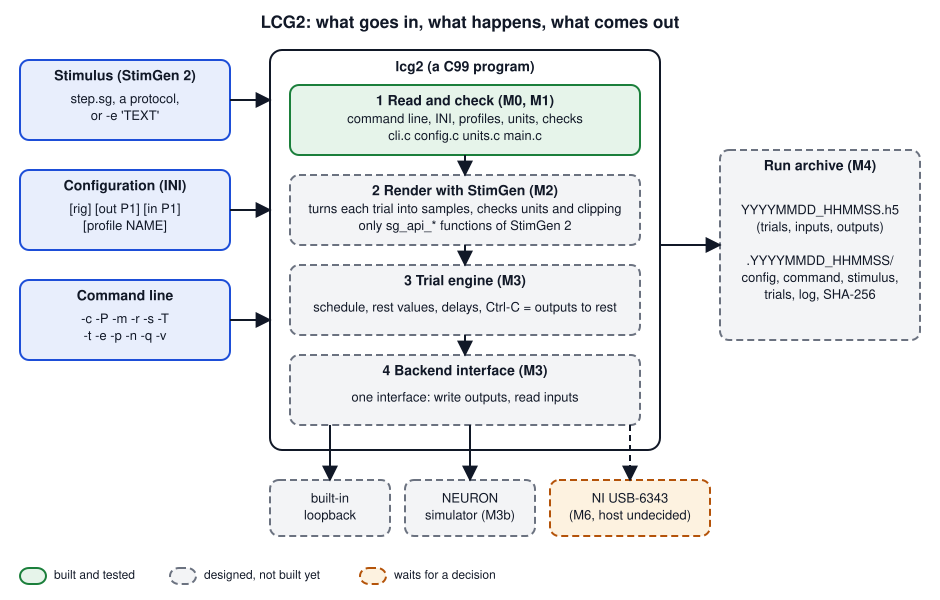

# LCG2

A minimal command-line program for cellular electrophysiology, written in ISO C99. It plays a
[StimGen 2](https://github.com/mgiugliano/StimGen2) stimulus on the analog and digital outputs of an acquisition
board and records the analog inputs at the same time. It is a stripped-down successor of the LCG software
(J Neurosci Methods): no dynamic clamp, no Comedi, no real-time kernel.

**Version 0.2.** Everything runs on a **simulator**: a built-in loopback, or **virtual cells in NEURON** that you
describe in the configuration file (the default is a Hodgkin–Huxley soma; bring your own morphology, biophysics and
channels if you like), recorded through a **realistic pipette and amplifier**: electrode resistance and capacitance, bridge
balance, capacitance neutralisation, series-resistance compensation, recording noise, and active electrode compensation. **The board is not supported yet**: no NI-DAQmx backend is written, and nothing in this
repository touches hardware. Each page of the manual says what is built and what is only designed.



## Try it in five minutes

```console
$ make                                           # needs a C99 compiler, HDF5, and ../StimGen (see below)
$ mkdir ~/lcg2_data && cd ~/lcg2_data            # a run writes its files in the current folder
$ L=/path/to/lcg2                                # the folder of this repository
$ $L/lcg2 -c $L/examples/single_pipette.ini -n $L/examples/step.sg     # check and print the plan, play nothing
$ $L/lcg2 -c $L/examples/single_pipette.ini $L/examples/step.sg        # play it
lcg2: done: 1 trial(s) in 2.000 s (simulated), largest delay 0.000 s; wrote 20261118_164908.h5 and .20261118_164908/
$ python3 $L/examples/read_run.py 20261118_164908.h5                   # look inside (pip install h5py)
```

A run leaves **two things**: `STEM.h5` (the data, one HDF5 group per trial) and a hidden folder `.STEM/` that holds
the exact configuration, command line, stimulus, log and SHA-256 checksums, so that anyone can repeat the run and
check that nothing changed.

**Patch a virtual cell** (needs `pip install neuron h5py`; set `sim_python` in the file to that Python):

```console
$ $L/lcg2 -c $L/examples/student_kit/rig.ini $L/examples/student_kit/current_steps.sg
$ python3 $L/examples/student_kit/characterise.py fi 2026*.h5          # f-I curve, input resistance
```

[`examples/student_kit/`](examples/student_kit/) is a package you can hand to a student: rigs, stimuli, models
and exercises. No NEURON knowledge needed.

## The idea in three lines

- The **stimulus** (StimGen text) says *what to play*, with channel names and no hardware.
- The **configuration** (INI) says *how the rig is wired*: which output carries `P1`, amplifier gains, safety limits,
  and, for the simulator, the virtual cells.
- The **command line** says *what to do today*: current or voltage clamp, which profile, which rate.

Outputs are never silently clipped, always end at a safe rest value (also on Ctrl-C), and every sample is checked
against the limits before anything is played.

## Build and test

```console
$ make              # checks the StimGen pin, builds ./lcg2 and the test tools
$ make test         # every suite, no hardware needed (python3; h5py for the recording tests)
$ make sanitize     # the same suites under AddressSanitizer and UBSan
```

You need:

- a C99 compiler and `make`;
- **HDF5** (the C library): `brew install hdf5` on a Mac, `sudo apt install libhdf5-dev` on Ubuntu;
- the StimGen 2 repository next to this folder (`../StimGen`, or `make STIMGEN_SRC=path/to/StimGen/src`). StimGen
  is not copied here: its version is pinned in [`STIMGEN_PIN`](STIMGEN_PIN) and checked at build time;
- optional: Python 3 with `h5py` (to read data and run the tests), and a Python with NEURON for `device = neuron`.

If a build inside a Dropbox folder fails at link time ("Resource deadlock avoided"): `make BUILD=/tmp/lcg2build`.

## Documentation

Start at **[`docs/README.md`](docs/README.md)**: quick start, tutorials, concepts, command-line and configuration
references, the data format, virtual cells, testing, an architecture guide for developers and
[a page for AI assistants](docs/11-for-ai-agents.md). The design is in [`SPEC.md`](SPEC.md); what changed between
versions is in [`CHANGELOG.md`](CHANGELOG.md).

## Layout

```text
src/       the program (C99)             examples/  rig configurations, stimuli, models, the student kit
neuron/    the NEURON adapter (Python)   docs/      the manual and its figures
vendor/    inih (BSD), unmodified        tests/     the test suites
SPEC.md    the design and the milestones
```

## Licence

MIT, see [`LICENSE`](LICENSE). `vendor/inih` keeps its own BSD licence.
