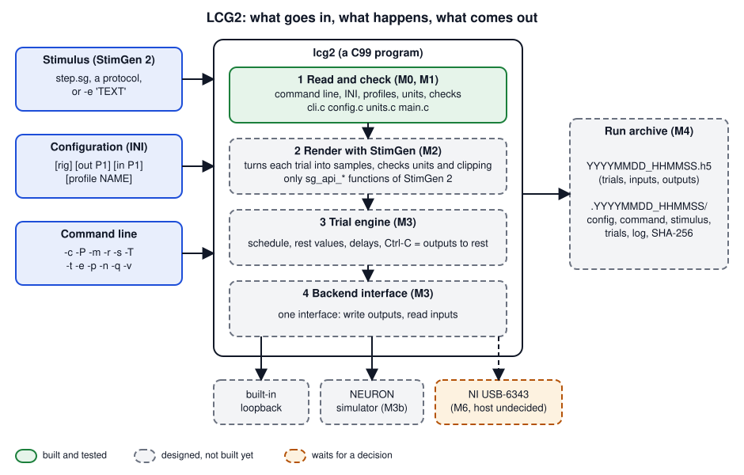
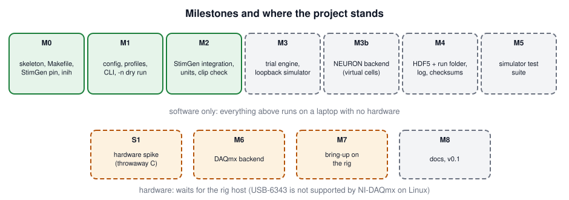

# 1. Overview

## The one job

LCG2 does one job:

1. take a **stimulus** written in the StimGen 2 language,
2. play it on the **outputs** of a data-acquisition board (analog and digital),
3. record the **inputs** at the same time, in physical units (pA, mV),
4. write everything, with the exact settings used, so the experiment can be
   repeated and checked later.

That is all. There is no graphical interface, no dynamic clamp, no real-time
kernel, no multitasking. The user types one command:

```console
$ ./lcg2 -c rig.ini -m cc -P pair stimulus.sg
```

and gets one data file and one hidden folder with the full record of the run.



## Three kinds of input, three kinds of knowledge

LCG2 keeps three things strictly apart, because they change at different
speeds:

| What | Where | Changes | Example |
|:--|:--|:--|:--|
| *What to play* | the **stimulus** (`.sg` text) | every experiment | a step of 200 pA on channel `P1` |
| *How the rig is wired* | the **configuration** (`.ini`) | when the rig changes | `P1` is on analog output 0, 400 pA per volt |
| *What to do today* | the **command line** | every run | current clamp, profile `pair`, 20 kHz |

The stimulus never names hardware. A stimulus channel called `P1` is just a
name; the configuration says which physical output carries `P1`, with which
amplifier gain. So the **same stimulus file works on any rig**, and a stimulus
can be re-addressed to another pipette without editing it.

## Why a successor to LCG

The original LCG suite (J Neurosci Methods, with Linaro and Couto) grew into a
large program with dynamic clamp, Comedi drivers and a real-time kernel. LCG2
keeps only the part most experiments need, and keeps it small enough to read:
about five thousand lines of C so far (including the test drivers), heavily commented. The unfinished Geko
project contributed ideas (the INI file, the run folder), not code.

## Design principles

- **Small and readable.** ISO C99, no dependencies beyond the standard library,
  inih (bundled) and HDF5 (to build `lcg2`). Every function has a comment that says why.
- **Nothing silent.** A value that would exceed a limit is an error, never
  quietly clipped. A rate the board cannot produce exactly is refused.
- **Reproducible.** Every run stores the exact configuration (with the profile
  resolved), the command line, the stimulus text, the seeds and the digests of
  every input.
- **Safe outputs.** Outputs end every trial at a *rest value*, and Ctrl-C drives
  them to rest before the program exits.
- **Same code for the simulator and the rig.** The program talks to a
  *backend*. The backend can be a built-in loopback, the NEURON simulator, or the
  real board; nothing else changes.
- **Portable.** Everything specific to an operating system will live in one file,
  so the program can run where the board's driver exists (see
  [09 Hardware](09-hardware.md)).

## What exists today

| Piece | Status |
|:--|:--|
| Command line, configuration file, profiles, units, checks, dry run (`-n`) | **Built** (M0, M1) |
| StimGen version pin and build check | **Built** (M0) |
| Calling StimGen to render trials; channel map, unit and clipping checks of every sample; the volts for the backend | **Built** (M2) |
| Trial engine: timing rules, rest values, Ctrl-C, streaming of the inputs | **Built** (M3) |
| Built-in loopback simulator (`device = sim`) | **Built** (M3) |
| NEURON simulator backend with virtual cells and synapses | **Built** (M3b) |
| HDF5 recording and the run folder | **Built** (M4) |
| NI-DAQmx backend for the USB-6343 | **Designed**, on hold (host undecided) |



## A word on the hardware

The board is a National Instruments USB-6343. NI's driver (NI-DAQmx) does not
support this USB model on Linux, which was found when the driver was installed
on the Linux machine `cajal`. The program is therefore built simulator first,
and the hardware part waits for a decision on where the board will run
(Windows, or a PCIe board on Linux). Details are in [09 Hardware](09-hardware.md).
