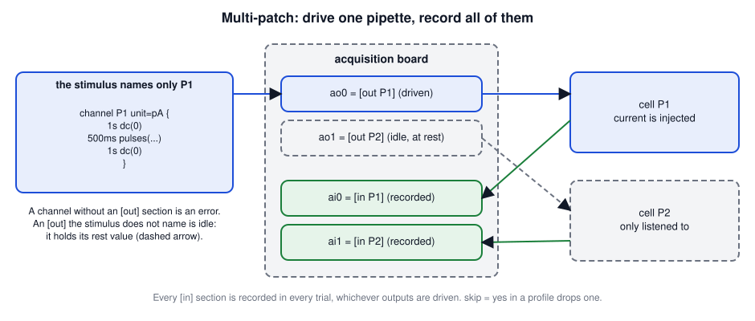
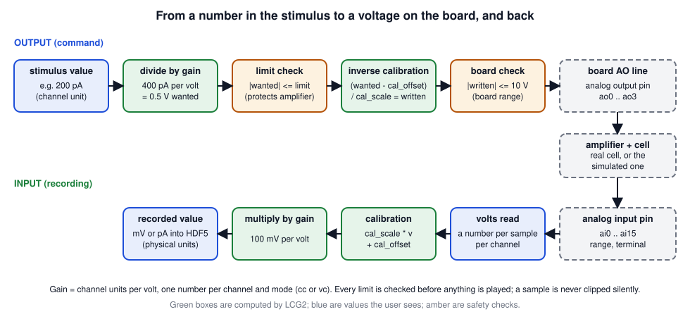

# 3. Tutorials

Each tutorial is short and can be followed in order. Lines that start with
`$ ./lcg2` are run by `make test`, so they stay true; the number after
`# exit` is the exit status the test expects. Run everything from the top
folder of the project.

> **Status.** All the tutorials below use the dry run `-n`, because playing and
> recording are not written yet. Tutorial 9 shows, clearly marked as a preview,
> what a full run is designed to look like.

Contents: [1 One pipette](#tutorial-1-one-pipette-in-current-clamp) ·
[2 Voltage clamp](#tutorial-2-the-same-rig-in-voltage-clamp) ·
[3 Two pipettes](#tutorial-3-two-pipettes) ·
[4 Re-addressing](#tutorial-4-sending-a-stimulus-to-another-pipette) ·
[5 Digital line](#tutorial-5-a-digital-trigger-line) ·
[6 Safety limits](#tutorial-6-safety-limits-and-the-rest-value) ·
[7 Record only](#tutorial-7-record-only) ·
[8 Your own rig](#tutorial-8-writing-the-configuration-of-your-own-rig) ·
[9 Preview of a run](#tutorial-9-preview-what-a-full-run-will-look-like) ·
[10 Check a stimulus with sg](#tutorial-10-checking-a-stimulus-with-sg)

---

## Tutorial 1: one pipette in current clamp

**Goal:** read a minimal rig and understand each line of the plan.

The rig is [`examples/single_pipette.ini`](../examples/single_pipette.ini):

```ini
[rig]
device = sim            ; sim = built-in simulator; a board name (Dev1) later
mode   = cc             ; current clamp (or -m vc on the command line)
rate   = 20kHz

[out P1]
line    = ao0           ; analog output 0 of the board
gain_cc = 400           ; 400 pA at the amplifier input per volt of the board
unit_cc = pA
gain_vc = 20            ; in voltage clamp: 20 mV per volt
unit_vc = mV
limit   = 5             ; never ask the board for more than 5 V (safety)

[in P1]
line    = ai0           ; analog input 0 records the pipette
gain_cc = 100           ; the amplifier output: 100 mV per volt
unit_cc = mV
gain_vc = 1000          ; voltage clamp: 1000 pA per volt
unit_vc = pA
```

and the stimulus is [`examples/step.sg`](../examples/step.sg): 500 ms at 0 pA,
one second at 200 pA, 500 ms at 0 pA, on a channel named `P1`:

```text
sg 2 stimulus
rate 20kHz

channel P1 unit=pA {
    500ms  dc(0)
    @step
    1s     dc(200)
    500ms  dc(0)
}
```

The names must agree: the stimulus channel `P1` is played on the output
`[out P1]`, and the recording `[in P1]` is the pipette's voltage.

```console
$ ./lcg2 -c examples/single_pipette.ini -n examples/step.sg
```

The plan lists one output and one input (see [Quick start](02-quickstart.md)
for a line-by-line reading).

**Try:** change `limit = 5` to `limit = 0.1` and run again. The stimulus of
200 pA needs 0.5 V, above the limit. Today only the idle (rest) value is
checked, so the plan still prints; from M2 on, LCG2 will refuse to start and
name the first sample that would clip. See [Tutorial 6](#tutorial-6-safety-limits-and-the-rest-value).

---

## Tutorial 2: the same rig in voltage clamp

**Goal:** see how one flag changes the gains and units.

```console
$ ./lcg2 -c examples/single_pipette.ini -n -m vc examples/step.sg
```

The output line now reads

```text
P1       -> ao0  20 mV per volt, limit 5 V, rest 0 mV
```

and the input

```text
P1       <- ai0  1000 pA per volt, range 10 V, RSE
```

In voltage clamp the command is a voltage (mV) and the recording is a current
(pA). Both sets of gains live in the file; `-m cc|vc` only chooses. If you
forget `-m` and the file has no `mode =` line, LCG2 refuses to guess:

```console
$ ./lcg2 -c examples/single_pipette.ini -n examples/step.sg
```

works because the file says `mode = cc`. If the file had no `mode =` line and
you gave no `-m`, LCG2 would stop with `the amplifier mode is not set` (exit
status 1): a wrong guess would apply the wrong gains.

> A stimulus written in pA cannot be played in voltage clamp. From M2 on the
> unit of each stimulus channel is checked against the mode: `pA` against `mV`
> is an error, `nA` against `pA` is fine.

---

## Tutorial 3: two pipettes

**Goal:** a multi-patch rig, driving one cell while recording both.

[`examples/lcg2.ini`](../examples/lcg2.ini) has two pipettes and a digital line.
The stimulus [`examples/pair.sg`](../examples/pair.sg) injects pulses into `P1`
and holds `P2` at a small negative current:

```text
channel P1 unit=pA { 1s dc(0)  @train  500ms pulses(amp=2000, rate=20Hz, width=1ms)  1s dc(0) }
channel P2 unit=pA { 2.5s dc(-50) }
```

```console
$ ./lcg2 -c examples/lcg2.ini -n examples/pair.sg
```



The rules, which the plan shows:

- A stimulus can name **any subset** of the outputs. Named outputs are driven.
- An output the stimulus does not name is **idle**: it holds its `rest` value.
- **Every `[in]` is recorded** in every trial, driven or not.
- A stimulus that names a channel with no `[out]` section is an error (from M2).

---

## Tutorial 4: sending a stimulus to another pipette

**Goal:** re-address a stimulus without editing it.

Two tools, both working today.

**Profiles** change the wiring for a whole session. `lcg2.ini` has two:

```ini
[profile single]        ; only pipette P1 is used
out.P2.skip = yes
in.P2.skip  = yes

[profile swap]          ; P2 is wired to analog output 2, and a slower rate
out.P2.line = ao2
rig.rate    = 10kHz
```

```console
$ ./lcg2 -c examples/lcg2.ini -n -P single examples/pair.sg
$ ./lcg2 -c examples/lcg2.ini -n -P swap examples/pair.sg
```

The first plan shows `P2 skipped` in both the outputs and the inputs. The second
shows `P2 -> ao2` and a rate of 10 kHz. A profile line is written
`section.key = value`: `rig.KEY` for `[rig]`, and `out.NAME.KEY`, `in.NAME.KEY`
for the others.

**`-T NAME`** sends a *plain waveform* (a single signal without a channel name)
to the pipette `NAME`. [`examples/ramp.sg`](../examples/ramp.sg) is one line:

```text
500ms dc(0); 1s dc(300); 500ms dc(0)
```

```console
$ ./lcg2 -c examples/lcg2.ini -n -T P2 examples/ramp.sg
```

The plan says `target  plain waveform to P2 (-T)`. `-T` must name an analog output
that is in use:

```console
$ ./lcg2 -c examples/lcg2.ini -n -T TTL -e x   # exit 1
```

fails with `-T: output 'TTL' is a digital line; a plain waveform needs an analog output`.

---

## Tutorial 5: a digital trigger line

**Goal:** a camera or shutter trigger played together with the current.

A digital line is declared with `digital = yes` and a port-0 line:

```ini
[out TTL]
line    = port0/line0
digital = yes
```

Only **port 0** can be clocked on the USB-6343, so any other port is refused:

```console
$ ./lcg2 -c examples/lcg2.ini -n examples/camera.sg
```

A digital line takes no gain, unit, limit, calibration or rest: it rests at the
value the stimulus gives it, otherwise 0. The stimulus
[`examples/camera.sg`](../examples/camera.sg) has a `digital TTL { ... }` block
whose values are 0 and 1 only.

---

## Tutorial 6: safety limits and the rest value

**Goal:** understand the two limits and why a bad idle value is refused.



An output has two limits:

1. `limit` (volts, you set it): the largest voltage that may appear at the
   amplifier's command input. It protects the amplifier and the cell.
2. 10 V: the range of the board itself, fixed.

The idle value `rest` (in pA for cc, mV for vc, default 0) is held before,
between and after trials. It is checked at load time. With `gain_cc = 400` and
`limit = 5`, a `rest` of 2100 pA would need 5.25 V:

[`examples/bad_rest.ini`](../examples/bad_rest.ini) is the single-pipette rig with
`rest = 2100` added on purpose:

```console
$ ./lcg2 -c examples/bad_rest.ini -n -e x   # exit 1
lcg2: examples/bad_rest.ini:17: [out P1] rest: 2100 pA needs 5.25 V at the amplifier command, above the limit of 5 V
```

The message names the file, the line, the section and the key, and gives the
numbers. A `rest` that goes past 10 V is refused too, with a message that says the
board's range would be exceeded "after calibration", because the calibration is
applied to the voltage before it is written.

Nothing is clipped silently anywhere in LCG2: a value that cannot be produced is
an error that names the file, the line and the numbers.

Rate is checked too. The board's analog input limit is 500 kS/s, shared by all
inputs in use:

```console
$ ./lcg2 -c examples/lcg2.ini -n -r 300kHz -e x   # exit 1
```

```text
lcg2: rate 300 kHz with 2 analog input(s) is above the board's 500 kS/s total (2 channel(s) at most 250 kHz each)
```

---

## Tutorial 7: record only

**Goal:** record without playing anything (to look at spontaneous activity).

```console
$ ./lcg2 -c examples/lcg2.ini -n -t 30s
```

`-t DURATION` replaces the stimulus: the outputs stay at rest and the inputs are
recorded for that long. The unit is required (`30s`, `500ms`, `2min`); a bare
`-t 30` is refused because it could mean seconds or minutes:

```console
$ ./lcg2 -c examples/lcg2.ini -n -t 30   # exit 1
```

---

## Tutorial 8: writing the configuration of your own rig

**Goal:** a checklist for a new rig. Start from `examples/single_pipette.ini`.

1. **Name your pipettes.** The name is a short identifier (`P1`, `cellA`). It will
   be the channel name in stimuli and the dataset name in the data file.
2. **Wire the outputs.** For each pipette make an `[out NAME]` with `line = ao0`
   to `ao3`. One analog output carries one pipette; two outputs cannot share a line.
3. **Wire the inputs.** For each recording make an `[in NAME]` with `line = ai0`
   to `ai15`. Choose `range` (0.2, 1, 5 or 10 V) and `terminal` (`RSE`, `NRSE`,
   `DIFF`) as the amplifier needs.
4. **Enter the gains.** They are *channel units per volt*, one pair per mode.
   Read them from your amplifier's manual. Example: a command sensitivity of
   400 pA/V is `gain_cc = 400`, `unit_cc = pA`; an output scale of 100 mV/V is
   `gain_cc = 100`, `unit_cc = mV` on the input.
5. **Set a `limit`.** Choose the largest command voltage you would accept. It
   costs nothing and prevents a typo from damaging a preparation.
6. **Check it:** `./lcg2 -c your.ini -n -e x`, once per mode (`-m cc`, `-m vc`).
7. **Calibrate (optional).** Measure the board with a voltmeter and enter
   `cal_scale` and `cal_offset` per channel (see [Concepts](04-concepts.md)).
8. **Add profiles** for the variations you use (single cell, swapped pipettes).

Every mistake gives a message with the file and the line; see
[12 Error messages](12-error-messages.md).

---

## Tutorial 9: preview: what a full run will look like

> **Designed, not built (M2 to M4).** The text below is a *mock-up* of the
> intended behaviour, not output from the program.

```console
$ ./lcg2 -c examples/lcg2.ini -m cc -P single examples/steps_protocol.sg
lcg2: 39 trials, rate 20 kHz, seed 13884263320379133600
lcg2: all trials checked: no sample clips
lcg2: trial 1/39  amp=-150pA  start 0.000 s  delay 0.000 s
lcg2: trial 2/39  amp= 250pA  start 5.000 s  delay 0.000 s
...
lcg2: wrote 20261118_142100.h5 and .20261118_142100/
```

and the folder holds the data file and a hidden folder with the record of
the run (the file names inside are provisional):

```text
20261118_142100.h5
.20261118_142100/
    config.ini        the resolved configuration, as in -n -v
    command.txt       the exact command line
    stimulus.sg       the stimulus text as given, and files it used
    trials.json       expanded trials, with seeds
    log.txt           trial starts, delays, warnings, SHA-256 of everything
```

Press Ctrl-C at any point and LCG2 will stop, drive every output to its rest
value, close the data file with the completed trials (the running one marked
`incomplete`), and exit with status 2.

---

## Tutorial 10: checking a stimulus with `sg`

StimGen has its own command-line tool, `sg`, which is useful *today* to write and
check stimuli before LCG2 can play them. Build it once in the StimGen folder and
use it:

```console
$ cd ../StimGen && make && cd ../lcg2        # builds ../StimGen/src/sg
$ ../StimGen/src/sg check examples/pair.sg
examples/pair.sg: ok, 2 channel(s), 50000 samples at 20000 Hz (2.5 s)
$ ../StimGen/src/sg check examples/steps_protocol.sg
examples/steps_protocol.sg: ok, 39 trial(s), protocol seed 13884263320379133600
$ ../StimGen/src/sg expand examples/steps_protocol.sg /tmp/steps    # list every trial as a file
```

All the `.sg` files in `examples/` pass `sg check`. See [07 StimGen and
LCG2](07-stimgen.md) for how LCG2 will use the same engine.
