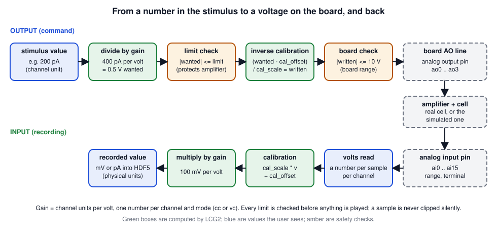
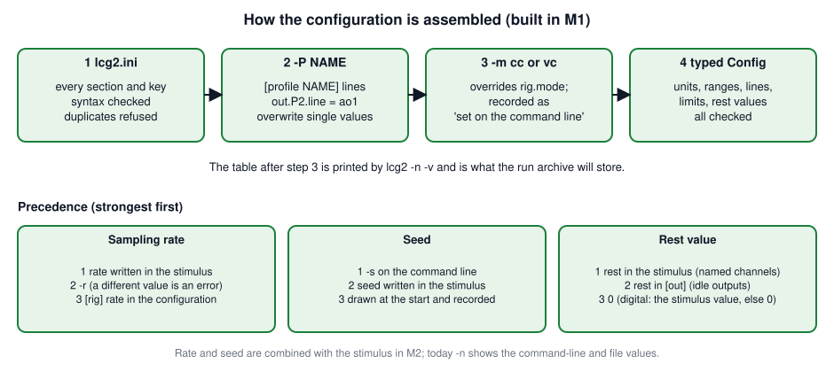
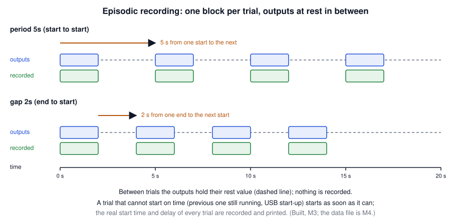

# 4. Concepts: the logic of LCG2

This page explains how LCG2 thinks. Read it once and the configuration file
and the messages will make sense. Marks: **Built** (in the code and tested) and
**Designed** (decided, not written yet); the recording and run archive (M4) are built.

Contents: [Channels and names](#1-channels-and-names) ·
[Units, gain, calibration](#2-units-gain-and-calibration) ·
[Limits and the rest value](#3-limits-and-the-rest-value) ·
[Amplifier modes](#4-amplifier-modes-cc-and-vc) ·
[The configuration is built in layers](#5-the-configuration-is-built-in-layers) ·
[Precedence rules](#6-precedence-rules) ·
[Trials and timing](#7-trials-and-timing) ·
[Recording](#8-recording-and-the-run-archive) ·
[Backends](#9-backends-simulator-and-board) ·
[Exit status](#10-exit-status-and-abort)

---

## 1. Channels and names

A **channel** is a named signal. The name is what ties the three kinds of input
together:

```text
stimulus text :  channel P1 unit=pA { ... }        <- names a signal "P1"
configuration :  [out P1]   line = ao0 ...         <- says where "P1" goes
                 [in  P1]   line = ai0 ...         <- says what is recorded
```

- An `[out NAME]` carries the stimulus channel `NAME` to a physical output line.
- An `[in NAME]` is a recorded input. Its name appears in the data file.
- A pipette usually has both, with the same name, but they are independent
  sections: you can record without driving, or drive without recording.
- A name is an identifier: a letter or `_`, then letters, digits and `_`, at
  most 47 characters.

The stimulus never names hardware. That is why a stimulus can be re-addressed
(see [profiles](#5-the-configuration-is-built-in-layers) and `-T`) without being edited.

## 2. Units, gain and calibration

LCG2 stores and talks in **physical units** (pA, mV). The board only knows volts.
Two numbers per channel connect them.

### Gain

The gain is **channel units per volt**, one number per channel and per mode. An
output with `gain_cc = 400`, `unit_cc = pA` turns 400 pA into 1 V. An input
with `gain_cc = 100`, `unit_cc = mV` turns 1 V into 100 mV. The same rule holds
for outputs and inputs, so there is no confusion between "divide" and "multiply".

### Calibration

The amplifier gain is not the whole story: the board's analog converters have
small errors. A bench calibration (measure with a voltmeter) gives two numbers
per channel: `cal_offset` in volts (default 0) and `cal_scale` (default 1).

```text
v_true = cal_scale * v_nominal + cal_offset
```

For an **input**, LCG2 applies this to the volts it reads. For an **output** it
applies the inverse to the volts it wants:

```text
written = (wanted - cal_offset) / cal_scale
```

> **Note.** The names `cal_offset` and `cal_scale` come from the Geko project,
> which defined them but never used them. The formula above is LCG2's own and is
> waiting for the owner's confirmation (see `SPEC.md`, section 4a).

### Worked example

Output `P1`: `gain_cc = 400` (pA/V), `cal_scale = 1.002`, `cal_offset = 0.01`.

| Step | Value |
|:--|:--|
| the stimulus asks for | 200 pA |
| volts wanted at the amplifier command | 200 / 400 = 0.5 V |
| volts written to the board | (0.5 − 0.01) / 1.002 = 0.4890 V |

Input `P1`: `gain_cc = 100` (mV/V), same calibration.

| Step | Value |
|:--|:--|
| volts read at the board | 0.25 V |
| after calibration | 1.002 × 0.25 + 0.01 = 0.2605 V |
| recorded in the file | 0.2605 × 100 = 26.05 mV |



**Built:** the keys are read and checked, and applied to every sample when the volts for the
backend are made (M2). Which of the two limits applies to a *recorded* input is a later question.

## 3. Limits and the rest value

Every output has two limits, checked in this order:

1. `|wanted| <= limit`: the **limit** you set (volts), at the amplifier command.
   It protects the amplifier and the cell from a typo. Optional.
2. `|written| <= 10 V`: the **board range**, fixed by the hardware.

One pair of functions does both checks (`out_check_value()` in `src/config.c`) and
is used for the idle values now and, from M2, for every sample of every trial,
so the two cannot differ.

The **rest value** is where an output sits when it is not playing: before the
first trial, between trials, after the last one, and always at the end of every
buffer sent to the board. It is in the unit of the active mode, default 0.

- For a channel the stimulus names, the stimulus's own `rest` is used.
- For an `[out]` the stimulus does not name, the `rest` in the configuration is used.
- A digital line rests at the stimulus value, otherwise 0.

**Built:** the `rest` of every output in use is checked at load time, and (M2) **every
sample of every trial** is checked, plus the stimulus's own `rest` values, *before
anything is played*. A value that would exceed a limit is an error that names the
trial, channel, sample and numbers. A value that is not a finite number (NaN, infinity)
is refused too.

**Never silent.** If any sample would clip, LCG2 plays nothing, and the error
names the trial, the channel and the first sample.

## 4. Amplifier modes: cc and vc

The amplifier is either in current clamp (cc) or in voltage clamp (vc), chosen
with `-m cc|vc` or `mode =` in `[rig]`. The mode decides which gains are used and
which dimension each channel carries:

| | Output (command) | Input (recording) |
|:--|:--|:--|
| **cc** | current (pA, nA ...) | voltage (mV, V ...) |
| **vc** | voltage (mV, V ...) | current (pA, nA ...) |

Each channel has both sets of keys (`gain_cc`/`unit_cc`, `gain_vc`/`unit_vc`); only the
set of the mode in use is required. The dimension of each unit is checked, so
`unit_cc = mV` on an output is an error. The unit of each stimulus
channel is also checked against the unit of its output **by dimension**, not
by spelling (built, M2): `nA` against `pA` is fine (it is rescaled), `pA` against `mV` is an
error.

There is no default mode. If neither `-m` nor `mode =` is given, LCG2 stops:
guessing would apply the wrong gains.

## 5. The configuration is built in layers



1. **The file** (`lcg2.ini`) is read into a flat list of entries
   `(section, key, value, line)`. Only syntax is checked: sections, names, no
   duplicates.
2. **A profile** (`-P NAME`) rewrites single entries: a line `out.P2.line = ao1`
   in `[profile NAME]` replaces the value of `line` in `[out P2]`. A profile
   can set `skip = yes` to drop a channel for this session.
3. **The command line** can override the mode (`-m`). That value is written into
   the table and marked `set on the command line`.
4. **The typed configuration** is built from the table and every key is
   checked: known name, well-formed value, units of the right dimension, legal
   lines, no two channels on one line, rest values within limits.

The table after step 3 is what `lcg2 -n -v` prints and what the run archive will
store. Loading that text again, without the profile and without `-m`, gives the
same plan (a test checks this round trip).

**Why a flat table first?** A profile must patch single values, and the archive
must store exactly what was used. Both are trivial on a list of text entries and
awkward on typed structures.

## 6. Precedence rules


| Quantity | Rule |
|:--|:--|
| **Sampling rate** | A rate written in the stimulus is used. An explicit `-r` that differs from it is an error. With neither, the `rate` in `[rig]` is used. The rate must be feasible, and LCG2 reads back the rate the driver really obtained and refuses unless it is exactly the one asked for. |
| **Seed** | Only `-s` overrides a seed written in a stimulus or protocol. The configuration has no seed. With no seed anywhere, one is drawn and recorded. |
| **Rest value** | The stimulus's `rest` for channels it names; the configuration's `rest` for idle `[out]` sections; 0 otherwise. |

**Built (M2):** combining them with what the stimulus states, in every case (see
[07](07-stimgen.md) for the table). The run's rate is read back from the rendered trial.

Rates are held as exact fractions (`p/q` Hz), never as floating point, so that
`20kHz` is exactly 20000 and two rates compare exactly.

## 7. Trials and timing

A StimGen **stimulus** is one trial. A StimGen **protocol** is a list of trials:
a sweep of parameters, repetitions, an order (sequential, shuffled, ...) and
timing. StimGen expands a protocol into an ordered list, with the seed of each
trial, before anything is played (built, M2: see [07](07-stimgen.md)).



Timing is either `period` (each trial starts a fixed time after the *start* of the previous
one) or `gap` (a pause after each trial *ends*). These are StimGen's own definitions. A trial can also say
`start on trigger` and wait for an edge on the PFI line named by `trigger` in
`[rig]`, or for Enter if no `trigger` is configured.

LCG2 plays the trials **one at a time**: each is rendered, played and recorded
before the next is rendered. Because rendering is deterministic, a trial can be
rendered again whenever needed. Between trials the outputs hold their rest
values. If a trial cannot start on time (the previous one is still running, or
the USB transfer needs time to start), it starts as soon as it can, and the real
start time and the delay are recorded and printed. `gap 0s` cannot be exact on
real hardware for the same reason.

**Built (M3).**

Two details of the timing, both measured by the tests. First, the **delay** of a trial is
when it really started minus when it was meant to start, and it includes the time the
backend needs to start (the *start latency*; zero in the simulator unless a test adds some,
a real number on USB hardware). Second, because `period` counts from the previous trial's
*actual* start, a start latency also moves the next trial: with 15 ms of latency every trial
slips another 15 ms, so a thousand trials end 15 s late. This follows StimGen's wording; a
fixed grid (each trial meant to start at `period` times its index) would not drift, and
`SPEC.md` 4c lists it as a choice the owner may change.

## 8. Recording and the run archive

Recording is **episodic**: inputs are recorded only while a trial plays, one
block per trial. Every `[in]` section is recorded in every trial, whichever
outputs are driven; a profile can drop one with `skip = yes`.

Every run produces a uniquely named data file and a hidden folder with the same
stem:

```text
[PREFIX_]YYYYMMDD_HHMMSS.h5          the data (HDF5)
.[PREFIX_]YYYYMMDD_HHMMSS/           the record of the run
```

The hidden folder holds the exact configuration (profile resolved), the exact
command line, the stimulus text as given and every file it used, the expanded
text and seed of each trial, and a log with the SHA-256 of the data file and of
every input. Together they let someone repeat the run and check that nothing was
altered.

The HDF5 file has one group per trial (`trial_0000`, `trial_0001`, ...) with
datasets for each input (`ai/<name>`, in physical units), for the command
actually played (`ao/<name>`) and for markers. The rate, gains, calibration,
seed, start time (UTC), delay and an `incomplete` flag are attributes. Datasets
are extendable and the file is flushed after every trial, so a crashed run keeps
its completed trials.

**Built (M4).** The exact layout, with a reader, is in [13 Data format](13-data-format.md)
(and `SPEC.md`, section 4d). The stamp is local time; the folder is claimed with an atomic `mkdir`, so a run
never overwrites another. The hidden folder also holds `provenance.json` and `SHA256SUMS`
(`shasum -a 256 -c` checks it).

## 9. Backends: simulator and board

LCG2 does not talk to the board directly. It talks to a **backend** through one
small interface: write outputs, read inputs. Three backends are planned:

| `device =` | Backend | Status |
|:--|:--|:--|
| `sim` | built-in loopback: each output feeds the input of the same number, plus noise | **Built** (M3) |
| `neuron` | the NEURON simulator, with virtual cells and synapses | Designed (M3b) |
| a board name (`Dev1`) | NI-DAQmx on the USB-6343 | Designed, on hold |

Everything above the backend (command line, config, rendering, trial engine,
recording, archive) is identical for all three. See [08 Simulators](08-simulators.md).

## 10. Exit status and abort

| Status | Meaning |
|:--|:--|
| 0 | success (a dry run that printed its plan counts as success) |
| 1 | an error before the run started: bad command line, bad configuration, clipping, a rate the board cannot do |
| 2 | the run was aborted or failed after it had started |

Output goes to the right place: the plan of `-n` and the help of `-h` go to
**stdout**; progress and errors go to **stderr**; data goes to files. Every
error message starts with `lcg2: `.

**Abort (built, M3).** Ctrl-C (SIGINT) and `kill` (SIGTERM) only set a flag. The code that
waits, and the loop that reads the inputs, check it; the program then stops, drives every
output to its rest value, and exits with status 2. The handler never does the work itself,
because a signal can interrupt the program at any instant. A second Ctrl-C does not skip
the rest step. The completed trials are closed in the HDF5 file and the
running one is marked `incomplete` (built, M4).

**What cannot be caught.** `kill -9` (SIGKILL), a power cut or a crash end the program at
once; nothing can run after them. A real board then keeps the last values it was given. That
is why every buffer ends with rest samples, and why the bring-up tests (M7) check the outputs
on a scope for Ctrl-C, `kill` and an unplugged USB cable.

**If putting the outputs at rest fails** (it cannot with the simulator; on a board it can),
LCG2 says so loudly, even with `-q`: `ERROR: the outputs may NOT be at rest`, and the exit
status is 2 even if the run itself had succeeded.
