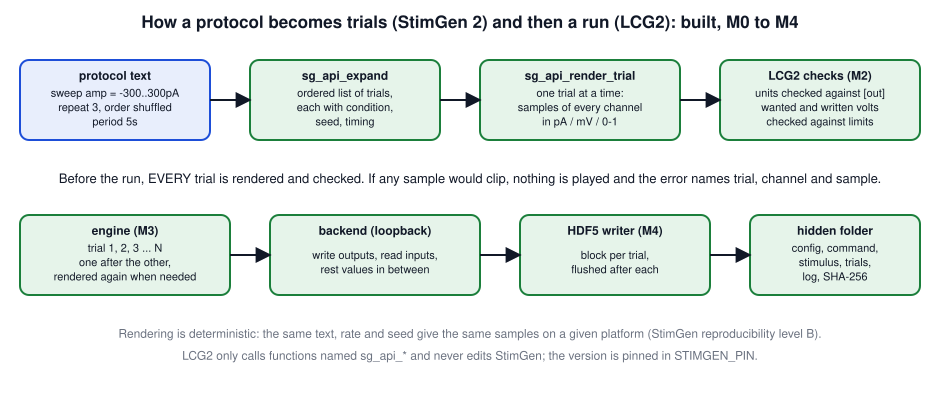

# 7. StimGen and LCG2

[StimGen 2](https://github.com/mgiugliano/StimGen) is a separate project: a
language and a reference renderer for electrophysiology stimuli. LCG2 does not
re-implement it. LCG2 **calls the StimGen C library** to turn the text of a
stimulus or protocol into samples.

> **Status.** The *link* is not written yet (milestone M2). Today LCG2 compiles the
> StimGen library with its own flags, to prove that the build is clean, and
> checks that the sources are the pinned version. It does not call it. This
> page describes the designed use.

## Why a library and not a pipe

LCG2 takes StimGen **text**, not `.sgb` files, for three reasons:

1. A **protocol** is not one file: expanded, it is a directory of trials. Text
   avoids that.
2. The **sampling rate** is decided by the rig, and the stimulus may state it. With
   text, LCG2 passes the rate to StimGen and gets the samples it needs, with no
   resampling.
3. LCG2 needs the **trial list** with seeds and timing, and one trial at a time.

`.sgb` input may be added later; it is out of scope for now.

## The library interface (`sg_api_*`)

LCG2 uses **only** the functions named `sg_api_*` (from `src/sg_api.c` in
StimGen). They are the interface also used by the WebAssembly build. Their key
property: they set an error trap, so a StimGen error **returns** a message
instead of calling `exit()`. That matters when the outputs of a board are live.

| Function | What LCG2 uses it for |
|:--|:--|
| `sg_api_kind(text)` | is this a waveform, a stimulus or a protocol? |
| `sg_api_expand(text, seed)` | the ordered list of trials of a protocol, as JSON, with seeds and timing |
| `sg_api_render_trial(text, rate, seed, unit, trial_json, protocol_text)` | the samples of one trial, as a complete `.sgb` byte string |
| `sg_api_render(text, rate, seed, unit)` | the samples of a plain waveform or single stimulus |
| `sg_api_check(text, unit)` | a summary of a stimulus as JSON (channels, rate, duration) |
| `sg_api_error()` | the message of the last error (with the line number) |
| `sg_api_warnings()` | warnings, which LCG2 logs |
| `sg_api_result()`, `sg_api_result_size()` | the bytes of the last result |

Every function returns 0 on success and -1 on error. Results stay valid until the
next call. Nothing is printed.

## What LCG2 will do with the samples (M2)



1. Read the stimulus text (from the file or from `-e`).
2. Decide the rate (the stimulus's, `-r`, or `[rig] rate`; see [04](04-concepts.md)).
3. If it is a protocol, expand it into the list of trials.
4. **Render every trial and check it** before anything is played: the unit of
   each stimulus channel against the unit of its `[out]` (by dimension, with
   rescaling: `nA` against `pA` is fine); the volts wanted and written against
   `limit` and 10 V for **every sample**; every named channel has an `[out]`.
   If one sample would clip, nothing is played, and the error names the trial,
   the channel and the first sample.
5. During the run, render trials one at a time, again (rendering is
   deterministic).

The checks in step 4 use the same functions that already check the idle values
today (`out_check_value()`), so the two cannot disagree.

## Names and units

A StimGen `channel NAME unit=pA { ... }` is played on the `[out NAME]` of the
configuration. A StimGen `digital NAME { ... }` is played on a digital `[out NAME]`
(`digital = yes`, `line = port0/lineN`). The stimulus's unit is **checked
against the dimension** of the output's unit for the mode: current for cc,
voltage for vc.

## Reproducibility

StimGen gives *reproducibility level B*: the same text, rate and seed give the
same samples on a given platform. LCG2 stores the stimulus text, the rate and the
seed of every trial, so a run can be repeated.

## The pin

LCG2 was built and tested against **one specific version** of StimGen. It never
copies StimGen. Instead [`STIMGEN_PIN`](../STIMGEN_PIN) records:

- the git commit,
- the StimGen version string,
- a **SHA-256 fingerprint** of the library sources (`util.c help.c render.c rng.c
  parse.c prims.c eval.c protocol.c sgb.c sg_api.c sg.h`, concatenated in that order).

`make` recomputes the fingerprint from `../StimGen/src` (or `STIMGEN_SRC`) and
**stops** if it differs, so a different renderer is never used by accident. The
pin has a test (`tests/run_tests.py`): a faithful copy is accepted, a changed
or missing file is refused.

**When you change StimGen on purpose** (a bug fix, a new feature):

```console
$ cd ../StimGen/src
$ cat util.c help.c render.c rng.c parse.c prims.c eval.c protocol.c sgb.c sg_api.c sg.h | shasum -a 256
```

then re-run `make test` in LCG2, and write the new hash and commit into
`STIMGEN_PIN`. The point is that the update is a decision, not an accident.

## What LCG2 never does to StimGen

- never edits it (it is a separate repository);
- never writes inside its folder (it has object files of its own; LCG2 compiles
  into its own `build/stimgen/`);
- never calls anything but `sg_api_*`.

## A note found while building

StimGen's rate parser accepted malformed exponents as if they were valid
(`1ee3Hz`, `1e+Hz` and `1eHz` all read as 1 Hz). LCG2 refuses them. The fix belongs to
StimGen (the owner is making it); once it lands, update the pin.

## The language in one page

Look at the StimGen documentation for the full language. The examples used in
LCG2 are in [`examples/`](../examples/):

| File | What it shows |
|:--|:--|
| [`step.sg`](../examples/step.sg) | one current step on one channel |
| [`pair.sg`](../examples/pair.sg) | two channels, a pulse train and a held current |
| [`camera.sg`](../examples/camera.sg) | an analog channel with a digital trigger line |
| [`steps_protocol.sg`](../examples/steps_protocol.sg) | a *protocol*: a sweep of amplitudes, repeated, shuffled |
| [`frozen_noise.sg`](../examples/frozen_noise.sg) | a protocol that repeats the same noise realisation 50 times |
| [`ramp.sg`](../examples/ramp.sg) | a *plain waveform*, played with `-T NAME` |

All of them pass `sg check`.
