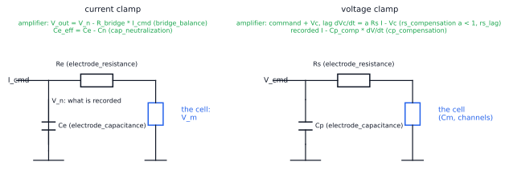
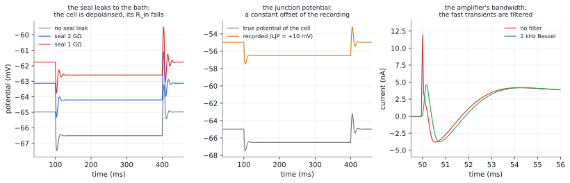

# 14. Virtual cells: patching on the NEURON simulator

> **Status: built (milestone M3b), with a pipette and amplifier model since 0.2 (seal, junction potential and bandwidth since 0.3).** `device = neuron` works with NEURON 8.2.6 (Mac,
> Python 3.11) and NEURON 9.0.2 (Ubuntu 22.04, Python 3.10). It is tested by `tests/test_neuron.py` (188 checks). The numerical result
> equals a plain NEURON script to 1e-9 mV (see [How a trial is simulated](#how-a-trial-is-simulated)).

**The idea.** Everything you do on the real rig you do here, with the same command line, the same
stimulus files and the same configuration, except that the cells are virtual. You never write NEURON
code, and you never run NEURON yourself: `lcg2` starts it, builds the cells that your configuration
describes, plays your stimulus into them, and records what the electrodes would have measured. Hand a
student the folder [`examples/student_kit/`](../examples/student_kit/) and tell them to train; the twelve tutorials
with figures are in [16 Tutorials with virtual cells](16-neuron-tutorials.md).

```text
  lcg2  ── stimulus (StimGen) ── volts ──►  inverse of the amplifier  ──► pA / mV ──┐
   │                                                                                 ▼
   │                                                           lcg2_neuron.py  ──►  NEURON  (cells, synapses)
   │                                                                                 │
   └── HDF5 file, run folder  ◄── volts ◄──  the amplifier, as on the board  ◄── mV / pA ┘
```


## Five minutes

Needs a Python that has NEURON (`pip install neuron`). The kit says `sim_python = python3`, right when your virtual environment is
active; otherwise put the path of that Python in `sim_python`, or set the environment variable `LCG2_SIM_PYTHON`, which overrides the file.

```console
$ ./lcg2 -c examples/student_kit/rig.ini -n examples/student_kit/current_steps.sg
$ ./lcg2 -c examples/student_kit/rig.ini examples/student_kit/current_steps.sg
```

The first builds the cell and prints what it made (and plays nothing). The second plays nine current steps
and writes a data file in the **current folder**, so run it from a data folder (`cd ~/my_data`) with the
full path to `lcg2` and to the kit. Then measure:

```console
$ python3 examples/student_kit/characterise.py fi 20261118_172433.h5
```

Change the cell with a profile, not by editing code: `-P ballstick`, `-P pyramidal`, `-P hoc`.

## What you write: the configuration

A virtual rig is the configuration of a real one, plus cells. The pipette `P1` is attached to the cell
`[cell P1]` of the same name. That is the whole rule.

```ini
[rig]
device     = neuron
sim_python = python3     ; or the path of a Python that has NEURON (LCG2_SIM_PYTHON overrides it)
mode       = cc
rate       = 20kHz

[out P1]  line = ao0   gain_cc = 400  unit_cc = pA     ; what you command
[in  P1]  line = ai0   gain_cc = 100  unit_cc = mV     ; what you record

[cell P1]
model = hh_soma
```

**What an electrode does is decided by the units of its channels**, so there is no separate "electrode"
section: a command in **pA** (current dimension) drives a current clamp (an `IClamp`); a command in **mV**
drives a voltage clamp (a `SEClamp`). An input in **mV** records the membrane potential where the electrode
sits; an input in **pA** records the current the electrode injects (the clamp current in voltage clamp). So
`-m cc` and `-m vc` work exactly as on the rig: they choose which unit each channel has.

The pipette has a cell, but a cell needs no pipette: a cell with no `[out]`/`[in]` is part of the network
and unrecorded (a presynaptic partner, for instance). An `[in P1]` with no `[out P1]` is a recording-only
electrode (voltage only).

### `[rig]` keys for `device = neuron`

| Key | Default | Meaning |
|:--|:--|:--|
| `sim_python` | `python3` | the Python that has NEURON. If it has none, the error names this key. **The environment variable `LCG2_SIM_PYTHON`, if set, overrides it** (so one file works on every machine) |
| `sim_script` | the adapter that ships with LCG2 | only to replace the adapter; a relative path starts in the folder of the configuration file |
| `sim_dt` | `25us` | the largest integration step. A sample period is divided into the fewest equal steps no larger than this (or than the smaller step an amplifier filter or a lagged compensation needs: see [The step](#the-step)) |
| `sim_celsius` | `6.3` | temperature in °C (global in NEURON): the classical squid axon |
| `sim_v_init` | `-65` | mV, the potential every cell starts from |
| `sim_settle` | `0s` | time the cells run at rest before the first trial (it also runs after your `init` code) |

### `[cell NAME]` keys

| Key | Meaning |
|:--|:--|
| `model` | `hh_soma` (default), `ball_and_stick`, or a path to a `.py` or `.hoc` file |
| `template` | for a `.hoc` model: the name of the template (a `begintemplate`) to instantiate |
| `morphology` | a path to an `.swc` or `.asc` file (instead of `model`) |
| `biophysics` | `passive`, `hh_soma`, or a path to a `.py` or `.hoc` file, applied after the morphology (default for a morphology: `hh_soma`) |
| `init` | a path to a `.py` or `.hoc` file, run after the cells are built and initialised (set states, shift the potential) |
| `mechanisms` | a folder of `.mod` files; compiled once, automatically, into a cache (never into your folder) |
| `electrode` | where the pipette sits: `soma(0.5)` (default), `dend[2](1)`, `apical(0.5)` ... |
| `series_resistance` | voltage clamp only, MΩ (default 1, NEURON's own); `electrode_resistance`, when given, replaces it |
| `same_as` | the cell of an earlier `[cell]`: a **second electrode on the same cell** (give it its own `electrode` and electrode keys) |
| the electrode and amplifier keys | `electrode_resistance`, `electrode_capacitance`, `recording_noise`, `noise_seed`, `bridge_balance`, `cap_neutralization`, `rs_compensation`, `rs_lag`, `cp_compensation`, `seal_resistance`, `liquid_junction_potential`, `amplifier_bandwidth`: see [The pipette and the amplifier](#the-pipette-and-the-amplifier) |
| `d_lambda` | morphology only: the *d_lambda* rule for the number of segments (default 0.1; 0 keeps what the file gives) |
| the patching keys | `pipette_resistance`, `pipette_capacitance`, `access_resistance`, `seal_target`, `patch_resistance`, `patch_capacitance`, `patch_seed`, `seal_failure`, `break_in_success`, `pipette_offset`, `patch_start`, `patch_contact`, `patch_suction`, `patch_break_in`, `patch_zap`, `zap_success`, `patch_holding`: see [Patching](#patching-from-the-bath-to-whole-cell). They are reserved: a model cannot have a parameter of these names |
| anything else | a **parameter of the model**: passed to your model, and an error if the model does not take it |

Relative paths start in the **folder of the configuration file** (not in the folder you run from), so a
package that holds the configuration and its model files works from anywhere. This differs from `use` and
`file()` inside a stimulus, which start in the current folder.

### `[synapse NAME]` keys

| Key | Default | Meaning |
|:--|:--|:--|
| `pre`, `post` | (required) | names of two `[cell]` sections |
| `type` | `exp` | `exp` (one time constant `tau`) or `exp2` (`tau1` rise, `tau2` decay) |
| `weight` | `0.001` | µS (accepts `nS`, `uS`, `mS`) |
| `delay` | `1ms` | axonal and synaptic delay |
| `tau` | `2ms` | `exp`; `tau1` `0.5ms` and `tau2` `2ms` for `exp2` |
| `e` | `0` | reversal potential, mV |
| `threshold` | `0` | mV, the presynaptic crossing that releases |
| `pre_location`, `post_location` | the cell's `electrode` | where on the cells, such as `dend[0](0.5)` |

## The cells you can have

### Built in

* **`hh_soma`**: one 20 µm Hodgkin–Huxley compartment. Parameters: `diam`, `length` (µm), `cm` (µF/cm²), `ra`
  (Ω·cm), `gnabar`, `gkbar`, `gl` (S/cm²), `el` (mV).
* **`ball_and_stick`**: the same soma with one passive dendrite. Adds `dend_length`, `dend_diam` (µm), `dend_nseg`,
  `dend_ra`, `dend_g` (S/cm²), `dend_e` (mV). Sections: `soma` and `dend`; try `electrode = dend(1)`.

### A model in Python

[`examples/models/pyramidal.py`](../examples/models/pyramidal.py) is a complete example. LCG2 looks for, in
this order: a function `build(...)`, a class `Cell`, or, if there are neither, treats the file itself as the
cell (a plain script that creates sections at the top level works). It returns **the cell**: any object whose
attributes are the sections (`cell.soma`, `cell.apical`, a list `cell.dend`). The keys of `[cell]` that LCG2
does not know arrive as keyword arguments, converted (`20` is a number, `yes` a boolean). Create sections as
`h.Section(name="soma", cell=self)` so that two cells of the same model do not clash.

### A model in hoc

[`examples/models/simple_cell.hoc`](../examples/models/simple_cell.hoc): with `template = SimpleCell`, the
template is instantiated (extra keys are passed as arguments, in file order). Without `template`, the file is
run and the sections it creates at the top level are the cell (so only one such cell per rig).

### A morphology you supply

```ini
[cell P1]
morphology = neuron.swc
biophysics = my_channels.py       ; or passive, or hh_soma
init       = my_start.py
```

[`tiny.swc`](../examples/models/tiny.swc), [`cell_tuning.py`](../examples/models/cell_tuning.py) and
[`start_depolarised.py`](../examples/models/start_depolarised.py) show the three files. The cell gets
`soma`, `dend`, `apic`, `axon` (lists of sections) and `all`. A **biophysics** Python file is run with
`cell`, `h`, `sections` and `params` in scope; if it defines a function `biophysics(cell, ...)` that is
called too. A hoc file defines `proc biophysics()`, which receives the cell's SectionList as `$o1` and the cell
object (or NULL) as `$o2`. An **init** file is the same with `initialize(cell)` / `proc initialize()`, run
*after* the cells are initialised, so states you set stay.

### Your own channels

`mechanisms = mod` (a folder of `.mod` files). The first run compiles them with `nrnivmodl` into
`~/.cache/lcg2/neuron/<digest of the files>` (set `LCG2_CACHE` to move it), which can take a minute and
prints its progress in `neuron.log`; later runs reuse the result, and changing a `.mod` file recompiles.
[`examples/models/mod/slowleak.mod`](../examples/models/mod/slowleak.mod) is a small example.

## How a trial is simulated

1. `lcg2` turns the volts of the stimulus **back into what the amplifier would have produced**: it inverts
   the output's calibration and gain (pA or mV). So the gains, the calibration and the limits you configured
   are exercised, exactly as on the board.
2. The cell is advanced one sample period at a time. **Sample *i* of an input is the value at the end of
   sample interval *i*, after the command of sample *i* has been applied for the whole interval.** The period
   is divided into the fewest equal NEURON steps no larger than `sim_dt` (20 kHz and 25 µs: two steps of
   25 µs). A test compares this with a plain NEURON script (an `IClamp` and `h.fadvance`): the two recordings
   differ by 1e-14 mV.
3. The cell's answer (mV or pA) is turned into the volts the board would have read, **clamped to the
   input's range and counted**: a spike beyond the range of `[in P1]` is clipped and the run says so, as a
   real digitiser would.
4. **Between trials the cells keep running**, at the rest values, for the time the clock shows between the end
   of a trial and the start of the next (`period` or `gap`). The state carries over: a short period leaves a
   cell that has not recovered. Time is virtual unless you give `-R`.
5. The trial is simulated in blocks of 0.1 s, so Ctrl-C is heard within a tenth of a second and an
   interrupted trial is kept, marked `incomplete`, like on the board.

Speed: the 39-trial protocol of tutorial 9 (190 s of simulated time, one HH soma, 20 kHz) took 9.5 s.
`-n` builds the cells too (about a second, more when `.mod` files must compile), so a mistake in a model
file is found before any trial.

## The pipette and the amplifier

By default an electrode is **ideal**: the cell receives exactly the command and the recording is exactly the cell's
potential. A real pipette is not, and the artefacts it adds are what you learn to correct on a real rig. Each
`[cell]` can describe its pipette (the amplifier's settings belong to the same pipette):

| Key | Unit | Default | Meaning |
|:--|:--|:--|:--|
| `electrode_resistance` | MΩ | 0 | the pipette's series resistance Re |
| `electrode_capacitance` | pF | 0 | the pipette's capacitance to ground, Ce (Cp in voltage clamp) |
| `recording_noise` | mV or pA, rms | 0 | white Gaussian noise on every recorded value of this pipette (in the unit of the channel): its rms at the sampling rate without a filter; with `amplifier_bandwidth` it passes the filter too |
| `noise_seed` | integer | 1 | the noise is reproducible; the stream goes on from trial to trial |
| `bridge_balance` | MΩ | 0 | current clamp: the amplifier subtracts Rb × I_cmd from the recording |
| `cap_neutralization` | pF | 0 | current clamp: positive feedback that cancels part of Ce (must stay below `electrode_capacitance`) |
| `rs_compensation` | percent | 0 | voltage clamp: the clamp adds `α Rs I` to its command (α below 100 %) |
| `rs_lag` | µs | 10 | voltage clamp: the time constant of the compensation loop (the LAG knob); 0 is an ideal, instantaneous compensation |
| `cp_compensation` | pF | 0 | voltage clamp: the recording subtracts `Cpc dV/dt` (the pipette capacitance transient) |
| `seal_resistance` | GΩ | 0 (none) | a finite seal: a leak from the cell's inside to the bath, `-(Vm - 0)/Rseal` into the cell; needs an `[out]` of the pipette |
| `liquid_junction_potential` | mV | 0 | the recording reads `Vm + LJP`; the cell really sits at the command minus LJP |
| `amplifier_bandwidth` | kHz | 0 (none) | everything recorded, its noise included, passes a 4-pole Bessel low-pass with this −3 dB corner (at most 100 kHz) |



**Current clamp.** The electrode is Re in series with the cell and Ce from its amplifier side to ground:
`(Ce − Cn) dVn/dt = I_cmd − (Vn − Vm)/Re`. The cell receives `(Vn − Vm)/Re` (the capacitance diverts the fast part of
the current) and the amplifier reports `Vn − Rb × I_cmd` plus noise. The node equation is solved exactly over each NEURON step,
so the result does not depend on the step (a test compares 25 and 1 µs). With `bridge_balance = electrode_resistance` the steady
drop `Re × I` is removed exactly (without Ce the balanced recording equals the ideal one sample for sample), but the capacitor still
delays the electrode node, so the balance alone overshoots at every step; neutralising most of Ce with positive feedback shrinks that
transient. The pipette starts at rest on the cell as initialised (`sim_v_init`, the `init` hooks).
**Voltage clamp.** The clamp's series resistance Rs (`electrode_resistance`, or `series_resistance`) separates the amplifier
from the cell: the cell sees the command minus `Rs × I`, so large currents are poorly clamped and fast ones are slowed.
`rs_compensation` is the usual positive feedback, and like a real amplifier's it acts through a low-pass with the time constant
`rs_lag`: `lag dVc/dt = α Rs I − Vc`, the clamp adding `Vc` to its command. The loop is stable below 100 % but rings when α is
large or the lag long, as on a rig (a test compares it with the exact solution of the circuit for a passive cell). `rs_lag = 0`
gives an ideal compensation instead: the clamp's series resistance becomes exactly `(1 − α) Rs`. The pipette capacitance Cp draws a
transient `Cp dV/dt` at every command step; `cp_compensation` cancels it. Both compensations are *settings you choose*, like on an
amplifier: too much is as bad as too little (the validity checks refuse a neutralisation at or above Ce and a compensation of 100 %).



**The seal.** A seal is never infinite: current leaks from the cell's interior to the bath, modelled as an extra conductance `1/Rseal`
with a reversal of 0 mV. With a 1 GΩ seal the small Hodgkin–Huxley soma rests 3.2 mV more depolarised, and its input resistance
falls from 77 to 42 MΩ (the cell is nonlinear: the leak moves it up the steep part of its conductance curve). In voltage clamp a
500 MΩ seal adds about −140 pA to the holding current at −70 mV. A seal that is too leaky for the time step is refused.
**The liquid junction potential.** Pipette and bath solutions differ, so the recorded potential is offset from the cell's by a constant:
`recorded = Vm + LJP`. In voltage clamp the cell sits at `command − LJP`. Nothing corrects it for you, as on a real rig.
**The bandwidth.** A real amplifier filters its output (a 4-pole Bessel filter, 2-10 kHz) before the digitiser: fast transients, such
as the pipette's capacitive spike and the onset of a step, are delayed and spread (their charge is kept), and the noise is reduced.
The filter runs at the NEURON step with the bilinear transform, so that it behaves like the analogue one: gain 0.7071 at the corner
and 0.2137 at twice the corner, within 0.25 % of the analogue filter from 0 to twice the corner (a test checks it against the
transfer function). The noise is added *before* the filter, as on a rig: white noise of the density that gives `recording_noise`
rms at the sampling rate, so through the filter its rms becomes `recording_noise × √(2 × ENBW / rate)`, where ENBW ≈ 1.05 × the
corner is the filter's noise bandwidth (0.3 mV at 20 kHz through 2 kHz: 0.137 mV).

### The step

The filter and the lagged compensation are computed at the NEURON step, and both need it small: a filter within 0.25 % needs
corner × step ≤ 0.0125 (the error of the bilinear transform grows as the square of the step: it would be 17 % at twice the corner
with corner × step = 0.1), and the compensation loop needs 20 steps per `rs_lag`. So within a trial the step is made as small as the
pipettes need, whatever `sim_dt` says: 6.25 µs for a 2 kHz filter, 0.5 µs for the default 10 µs lag. `neuron.log` says which step was
used and why, and `-n` shows it on the electrode's line (`step 0.5 us`). The pauses between trials, where nothing is recorded, run
at `sim_dt` with an ideal compensation, which has the same steady state, so a protocol does not take much longer: the 6-trial
voltage-clamp protocol of tutorial J3 with compensation takes about 2 s.

**Two electrodes on one cell.** `[cell V0]` with `same_as = P1` is a second pipette on the cell of `P1`: put its own
`electrode` (another section, or the same soma) and its own electrode keys, and use `[out V0]`/`[in V0]` as for any pipette.
It is how a dual recording is made, and how the tutorials get the true membrane potential, which a real experiment never has,
to check what a compensation did.

**Offline compensation.** [`examples/student_kit/aec.py`](../examples/student_kit/aec.py) implements active electrode
compensation (Brette et al. 2008) on a recording: tutorial J.

## Patching: from the bath to whole-cell

A `[cell]` with `pipette_resistance` gets a **patching pipette** instead of the electrode above: a pipette that starts in the
bath, touches the cell, seals, and breaks in, on a timeline written in the configuration (tutorial L). Its keys:

| Key | Unit | Default | Meaning |
|:--|:--|:--|:--|
| `pipette_resistance` | MΩ | (required) | the pipette, as measured in the bath |
| `pipette_capacitance` | pF | 0 | its capacitance (cancel it with `cp_compensation`, as on a rig) |
| `access_resistance` | MΩ | 2.5 × the pipette | the series resistance after the break-in, pipette included (a mean: each cell differs) |
| `seal_target` | GΩ | 2 | the seal a good pipette reaches (a mean) |
| `patch_resistance`, `patch_capacitance` | GΩ, pF | 10, 0.05 | the patch of membrane under the tip before the break-in |
| `seal_failure` | probability | 0.15 | how often a seal stops at 50 to 500 MΩ |
| `break_in_success` | probability | 0.7 | how often one suction pulse breaks the patch |
| `patch_seed` | integer | 1 | which pipette and cell (see below) |
| `pipette_offset` | `null` or `none` | `null` | the offset is nulled in the bath (the junction-potential error then appears in the cell), or not |
| `patch_start` | `bath`, `cell_attached`, `whole_cell` | `bath` | where the pipette is when the run starts |
| `patch_contact`, `patch_suction` | time | none | when the tip touches the cell; when suction starts the seal |
| `patch_break_in` | times | none | suction pulses to break the patch, one or more (`14s, 16s`) |
| `patch_zap` | times | none | zaps (a voltage pulse) to break the patch, one or more |
| `zap_success` | probability | 0.5 | how often one zap breaks the patch |
| `patch_holding` | time and mV, pairs | none | the amplifier's own holding potential, added to the command from those times on (`10s -70, 30s 0`); voltage clamp |

Also allowed: `recording_noise`, `noise_seed`, `amplifier_bandwidth`, `liquid_junction_potential`, `cp_compensation`, and in current
clamp `bridge_balance` and `cap_neutralization`. Refused with a message: the plain electrode's `electrode_resistance`,
`electrode_capacitance`, `seal_resistance` and `series_resistance`, and `rs_compensation` (not available on a patching pipette yet).
The times count from the start of the first trial (after `sim_settle`); events that fall in a pause between trials happen there too.

**The circuit**, solved by NEURON together with the cell (a `LinearMechanism`, implicit, so the open tip and the gigaohm seal sit side
by side without trouble):

```text
amplifier --- Rp --- tip ---+--- R to the bath: the open tip (1 Ohm), then the seal
(holds the command,         +--- to the cell: nothing in the bath; the patch (10 GOhm || 0.05 pF) once touching;
 or injects current)                           Ra - Rp after the break-in
```

The junction potential (`liquid_junction_potential`) sits between the pipette solution and the bath until the break-in. With the
offset nulled, a voltage-clamp reading in the bath is 0 pA at 0 mV, and in whole-cell the result is the same as the plain electrode's
convention: recorded = Vm + LJP, the clamped cell at command − LJP.

**The stages.** Bath: the tip is open. Contact: the resistance to the bath rises to 10–30 % of Rp over 0.3 s, and the patch couples
the tip to the cell. Suction: the resistance to the bath grows on a logarithmic scale to the seal, with a time constant of 1 to 4 s.
Break-in: if the attempt succeeds, the patch becomes the access path `Ra − Rp`, the junction disappears, and Ra creeps up linearly,
by 0 to 50 % in ten minutes.

**A seed is a cell.** Whether the seal forms, how high (lognormal around `seal_target`, σ 0.35 on the log scale) and how fast, which
break-in attempt works, Ra (lognormal around `access_resistance`, σ 0.25, at least 1.2 × Rp) and its drift are drawn **once**, from
`patch_seed` and the cell's name only: never from the time step, the rate or the mode. The same seed is the same cell in voltage and
current clamp, which is how you record from a cell in both (a run is in one mode: run again with `patch_start = whole_cell`). The values
drawn are kept in `network.json` of the run folder (`patch_truth`) and never shown by `-n` or the run, so that you measure them.
These distributions and probabilities are LCG2's choices, written in [SPEC](../SPEC.md) §4g.

### Live mode

`lcg2 -L` (live patching, in real time) runs the seal test while you act on the pipette with keys, as at a rig: **c** touch the cell,
**s** suction, **b** a suction pulse (break in), **z** a zap, **h** the holding potential (0 or −70 mV, the amplifier's own, added to
the command), **q** stop. The readout is one line, rewritten after each pulse; what a key did is printed above it, and a key that
cannot act says why (`nothing: suction in the bath does nothing: touch the cell first (c)`). It needs a terminal on standard input,
`device = neuron`, voltage clamp (`-m vc`: the live readout is the seal test) and a patching pipette (the first one in the file is the
one the keys act on).

A key is an event at the time it was pressed on the run's clock, scheduled in the cells' time at that moment; if the cells have
already been simulated past it (a block of 0.1 s is simulated ahead and played on time), it acts at once. A key is read between two
blocks, so within a tenth of a second. The k-th suction pulse (or zap) uses the k-th draw of the seed, exactly as the k-th time of
`patch_break_in` (or `patch_zap`) of a scripted timeline, so a session can be **replayed**: the run folder gets `live_replay.ini`, a
`[profile live_replay]` with the session's events as timeline keys; copy it into the configuration and run without `-L`, with
`-P live_replay`. The replay has the same events at the same simulated times and gives the same resistance at the same simulated
time (tested: to 0.02 % wherever the resistance changes slowly between pulses, exactly once it is stable). The profile also gives the
session's `patch_seed` and `patch_start`, so that a session run with another profile replays as the same cell; use the same configuration
file, since nothing else is in the profile. Its trials start on time, while in real time each started
a millisecond or two late and, with `period`, those delays add up (the log lists them): a pulse of the replay is not the pulse of the
same number in the session. `q` ends the run normally (exit status 0): the trial in progress is kept, marked incomplete. Ctrl-C still
aborts (exit status 2).

**Speed.** Live mode needs a computer that simulates the seal test faster than real time. Simulating one period of
`seal_test_live.sg` (a 20 ms pulse at 100 kHz and an 80 ms pause, at `sim_dt = 5us`) takes about 23 ms on the Mac of the
tested-versions table and 75 ms on the Ubuntu machine. Measured end to end (`-R`, 200 pulses, the data file written as it goes), every
pulse starts a little late, by a delay that stays the same and does not grow: 4.6 ms (median; at most 10.6 ms) on the Mac, 1.4 ms (at
most 1.9 ms) on Ubuntu, so the pulses come at 9.6 and 9.9 a second instead of 10. On a computer slower than real time every pulse
would start later than the one before, and the readout would update less and less often: the session still works and is still
exact. A pause with only patching pipettes runs in NEURON's own loop, refreshing the circuit every millisecond and exactly at every
event (3 times faster than step by step).

**The membrane test.** `membrane_test = yes` in an `[in]` (voltage clamp, a command in mV on the `[out]` of the same name, a current in pA)
makes LCG2 measure every trial as an amplifier's seal-test window does, print it and keep it (attributes of the input's dataset,
[13](13-data-format.md)): the step dV is the first change of the command, R = dV / (the change of the current at the end of the step),
I hold the current before it. If the current then decays as a cell's capacitance charging through Ra, the exponential is fitted from
the second sample after the step until it falls to 5 % (the first sample holds the pipette's own transient), giving Ra = dV / (I0 + dI),
Rm = R − Ra and Cm = τ (Ra + Rm) / (Ra Rm). It says why it gives no Cm when the transient lasts fewer than 5 samples per time constant
(sample faster: `seal_test.sg` uses 100 kHz), when the current still changes half-way through the step (a seal forming), or when Ra is
not smaller than Rm (cell-attached). It works from the recorded data alone, so it works on the real rig too; on the loopback simulator,
where an output is wired to an input, its numbers mean nothing. It is the estimate of a single passive compartment: a leaky seal, or
channels open at the holding potential, bias it, as on an amplifier. Its accuracy on the simulated soma (tested): R and Ra exact to
0.1 % and 1 %; τ as the circuit's to 1 % at NEURON's step; Cm 2.4 % high at `sim_dt = 5us`, because NEURON's backward Euler lengthens
a 133 µs time constant by 1.8 % at that step (and the seal sits at the tip, not at the cell). Use a finer `sim_dt` for a smaller error.

## What is saved

In the run folder (see [13 Data format](13-data-format.md)): `network.json` (the cells and synapses as they
were built, the NEURON version), `files/NN_name` (copies of every model, morphology, biophysics, init and `.mod`
file that was read), and `neuron.log` (everything the adapter and NEURON printed). All are in `SHA256SUMS`;
`provenance.json` has a `neuron` entry (the Python, the adapter and its digest, `dt`, temperature). The data
file has `device = neuron` and `virtual_time = 1`.

## When it goes wrong

| Message (shortened) | Meaning |
|:--|:--|
| `cannot import NEURON in ... Point sim_python ...` | the Python of `sim_python` has no NEURON: `pip install neuron`, and set the key |
| `cannot run /x/python: No such file...` | `sim_python` is not a program |
| `[out P1] has no [cell P1]` | a pipette needs a cell of the same name |
| `[cell P1]: 'gnabr' is not a parameter of the model hh_soma (its parameters: ...)` | a typo, or a parameter the model does not have |
| `... the file or folder 'x.py' does not exist (looked for /... ; relative paths start in the folder of the configuration file)` | the path |
| `[cell P1] electrode: the cell has no section 'dend'` | `electrode` names a section the model did not make |
| `the NEURON adapter stopped ... (exit status N): <last lines of its log>; its messages are in .STEM/neuron.log` | NEURON or the model crashed; the end of the log says why, and the completed trials are kept (exit status 2) |
| `the NEURON model produced a value that is not a number ... the model diverged` | an unstable model: shrink `sim_dt`, check the geometry and the channels |
| `mechanisms: nrnivmodl failed` | a `.mod` file does not compile; the compiler's messages are in `neuron.log` |
| `cap_neutralization (...) must stay below electrode_capacitance` / `rs_compensation must be below 100 percent` | an amplifier setting that would oscillate |
| `rs_lag must be 0 (ideal compensation) or at least 1 us` / `amplifier_bandwidth must be at most 100 kHz` | a setting no amplifier has (and that would need an absurdly small step) |
| `electrode_resistance ... is too small for sim_dt` | the lumped electrode would be numerically unstable: use at least the Re it names, or a smaller `sim_dt` |
| `same_as = 'X' must name a [cell] written EARLIER in the file` | a second electrode needs its cell defined first |
| `a patching pipette (pipette_resistance) has its own keys ...` | a key of the plain electrode on a patching pipette |
| `suction needs a contact before it` / `break_in needs a suction before it` / `the times must increase` | the timeline is out of order |
| `... belongs to a patching pipette: give pipette_resistance too` | a patching key on a cell without a patching pipette |
| `-L (live patching) needs a terminal: the keys are read from standard input` | `-L` with standard input redirected; nothing was written |
| `-L (live patching) runs the voltage-clamp seal test: give -m vc` | `-L` in current clamp; nothing was written |
| `-L (live patching) needs device = neuron and a patching pipette ...` / `live mode needs a patching pipette ...` | `-L` with the loopback, or without `pipette_resistance` |
| `no membrane test: it needs voltage clamp (-m vc), a command in mV ...` | `membrane_test = yes` in current clamp, or without a command in mV |

You can also check a configuration **without lcg2**, which is handy when you write a model:

```console
$ python3.11 neuron/lcg2_neuron.py --check examples/models/t1.ini
```

## Limits (what this does not do)

* **One electrode model**: a lumped pipette (Re, Ce), a first-order amplifier with the settings above, a seal leak
  with a 0 mV reversal, a constant junction potential and a 4-pole Bessel output filter; no whole-cell capacitance
  compensation (Cm), no prediction (supercharging) in the Rs compensation, no seal that changes with time, no junction potential that
  drifts, no filter on the command. Noise is white, Gaussian, on the recording only (not on the injected current); without a filter
  it has the same rms at every sample rate. In voltage clamp the pipette capacitance transient is spread over the one sample in which
  the command changes (its charge `Cp ΔV` is exact). NEURON's own integration is first order (backward Euler): fast transients are
  accurate to about the step over their time constant (the lagged compensation of a 10 MΩ, 90 % clamp is within 1.2 % of the exact
  solution). The simulation is stable only while Re × C(membrane under the electrode) exceeds `sim_dt` (the program says so and
  gives the smallest Re).
* **Patching:** a run is in one mode (whole-cell current clamp is a second run of the same cell); in live mode a key acts within a
  tenth of a second, and only the first patching pipette has keys; no series-resistance
  compensation on a patching pipette; the patch is passive (no single channels).
* **Not dynamic clamp.** The command is a recorded stimulus, fixed before the trial.
* Digital outputs are not connected to anything (no cell has a digital input); they are recorded in the file as
  commanded, as with every backend.
* A temperature, `v_init` and `dt` are global to the network.
* A morphology file is read through NEURON's Import3d: SWC (`.swc`) and Neurolucida (`.asc`) are supported by it;
  only SWC is tested here.
* It tests LCG2 and your analysis, **not** the behaviour of the board (clock routing, latency, noise): that is the
  purpose of the hardware work.

## For AI assistants: the adapter protocol

`src/backend_neuron.c` starts `neuron/lcg2_neuron.py` (`platform_spawn`: its own process group, stderr in
`.STEM/neuron.log`, SIGPIPE ignored, every wait a 100 ms poll that sees the abort flag). Messages are one
line of JSON, then raw native-endian float64: `init` (INI text of the cells, folder of the config, electrode
list with dimensions, `dt`, temperature, `v_init`, settle, `check`), `advance` (duration in ns and the rest
command per output), `trial` (rate p/q), `block` (count, then `count` floats per output; the reply carries
`count` floats per input), `quit`. Units on the pipe: pA, mV, ns. The adapter keeps the protocol on a private
copy of file descriptor 1 and points descriptor 1 at the log, because NEURON prints to stdout. The first
`set_rest` call only stores values; the cells are advanced through the pause at the next `play`, from
`clock_now()` minus the end of the previous trial.
