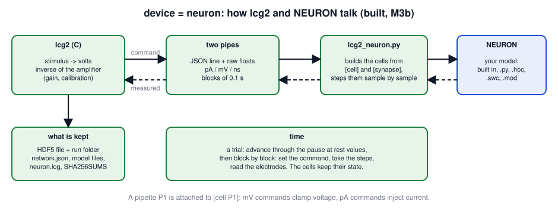

# 14. Virtual cells: patching on the NEURON simulator

> **Status: built (milestone M3b).** `device = neuron` works on the development Mac with NEURON 8.2.6
> (Python 3.11). It is tested by `tests/test_neuron.py` (77 checks). It has **not** been run on Linux or
> on any other NEURON version. The numerical result equals a plain NEURON script to 1e-9 mV (see
> [How a trial is simulated](#how-a-trial-is-simulated)).

**The idea.** Everything you do on the real rig you do here, with the same command line, the same
stimulus files and the same configuration, except that the cells are virtual. You never write NEURON
code, and you never run NEURON yourself: `lcg2` starts it, builds the cells that your configuration
describes, plays your stimulus into them, and records what the electrodes would have measured. Hand a
student the folder [`examples/student_kit/`](../examples/student_kit/) and tell them to train; the nine tutorials
with figures are in [16 Tutorials with virtual cells](16-neuron-tutorials.md).

```text
  lcg2  ── stimulus (StimGen) ── volts ──►  inverse of the amplifier  ──► pA / mV ──┐
   │                                                                                 ▼
   │                                                           lcg2_neuron.py  ──►  NEURON  (cells, synapses)
   │                                                                                 │
   └── HDF5 file, run folder  ◄── volts ◄──  the amplifier, as on the board  ◄── mV / pA ┘
```



## Five minutes

Needs a Python that has NEURON (`pip install neuron`); put its path in `sim_python` (the kit has the
path of the development Mac, `/opt/homebrew/opt/python@3.11/bin/python3.11`; change it).

```console
$ ./lcg2 -c examples/student_kit/rig.ini -n examples/student_kit/current_steps.sg
$ ./lcg2 -c examples/student_kit/rig.ini examples/student_kit/current_steps.sg
```

The first builds the cell and prints what it made (and plays nothing). The second plays nine current steps
and writes a data file in the **current folder**, so run it from a data folder (`cd ~/my_data`) with the
full path to `lcg2` and to the kit. Then measure:

```console
$ python3 examples/student_kit/characterise.py fi 20261118_172433.h5
```

Change the cell with a profile, not by editing code: `-P ballstick`, `-P pyramidal`, `-P hoc`.

## What you write: the configuration

A virtual rig is the configuration of a real one, plus cells. The pipette `P1` is attached to the cell
`[cell P1]` of the same name. That is the whole rule.

```ini
[rig]
device     = neuron
sim_python = /opt/homebrew/opt/python@3.11/bin/python3.11
mode       = cc
rate       = 20kHz

[out P1]  line = ao0   gain_cc = 400  unit_cc = pA     ; what you command
[in  P1]  line = ai0   gain_cc = 100  unit_cc = mV     ; what you record

[cell P1]
model = hh_soma
```

**What an electrode does is decided by the units of its channels**, so there is no separate "electrode"
section: a command in **pA** (current dimension) drives a current clamp (an `IClamp`); a command in **mV**
drives a voltage clamp (a `SEClamp`). An input in **mV** records the membrane potential where the electrode
sits; an input in **pA** records the current the electrode injects (the clamp current in voltage clamp). So
`-m cc` and `-m vc` work exactly as on the rig: they choose which unit each channel has.

The pipette has a cell, but a cell needs no pipette: a cell with no `[out]`/`[in]` is part of the network
and unrecorded (a presynaptic partner, for instance). An `[in P1]` with no `[out P1]` is a recording-only
electrode (voltage only).

### `[rig]` keys for `device = neuron`

| Key | Default | Meaning |
|:--|:--|:--|
| `sim_python` | `python3` | the Python that has NEURON. If it has none, the error names this key |
| `sim_script` | the adapter that ships with LCG2 | only to replace the adapter; a relative path starts in the folder of the configuration file |
| `sim_dt` | `25us` | the largest integration step. A sample period is divided into the fewest equal steps no larger than this |
| `sim_celsius` | `6.3` | temperature in °C (global in NEURON): the classical squid axon |
| `sim_v_init` | `-65` | mV, the potential every cell starts from |
| `sim_settle` | `0s` | time the cells run at rest before the first trial (it also runs after your `init` code) |

### `[cell NAME]` keys

| Key | Meaning |
|:--|:--|
| `model` | `hh_soma` (default), `ball_and_stick`, or a path to a `.py` or `.hoc` file |
| `template` | for a `.hoc` model: the name of the template (a `begintemplate`) to instantiate |
| `morphology` | a path to an `.swc` or `.asc` file (instead of `model`) |
| `biophysics` | `passive`, `hh_soma`, or a path to a `.py` or `.hoc` file, applied after the morphology (default for a morphology: `hh_soma`) |
| `init` | a path to a `.py` or `.hoc` file, run after the cells are built and initialised (set states, shift the potential) |
| `mechanisms` | a folder of `.mod` files; compiled once, automatically, into a cache (never into your folder) |
| `electrode` | where the pipette sits: `soma(0.5)` (default), `dend[2](1)`, `apical(0.5)` ... |
| `series_resistance` | voltage clamp only, MΩ (default 1, NEURON's own) |
| `d_lambda` | morphology only: the *d_lambda* rule for the number of segments (default 0.1; 0 keeps what the file gives) |
| anything else | a **parameter of the model**: passed to your model, and an error if the model does not take it |

Relative paths start in the **folder of the configuration file** (not in the folder you run from), so a
package that holds the configuration and its model files works from anywhere. This differs from `use` and
`file()` inside a stimulus, which start in the current folder.

### `[synapse NAME]` keys

| Key | Default | Meaning |
|:--|:--|:--|
| `pre`, `post` | (required) | names of two `[cell]` sections |
| `type` | `exp` | `exp` (one time constant `tau`) or `exp2` (`tau1` rise, `tau2` decay) |
| `weight` | `0.001` | µS (accepts `nS`, `uS`, `mS`) |
| `delay` | `1ms` | axonal and synaptic delay |
| `tau` | `2ms` | `exp`; `tau1` `0.5ms` and `tau2` `2ms` for `exp2` |
| `e` | `0` | reversal potential, mV |
| `threshold` | `0` | mV, the presynaptic crossing that releases |
| `pre_location`, `post_location` | the cell's `electrode` | where on the cells, such as `dend[0](0.5)` |

## The cells you can have

### Built in

* **`hh_soma`**: one 20 µm Hodgkin–Huxley compartment. Parameters: `diam`, `length` (µm), `cm` (µF/cm²), `ra`
  (Ω·cm), `gnabar`, `gkbar`, `gl` (S/cm²), `el` (mV).
* **`ball_and_stick`**: the same soma with one passive dendrite. Adds `dend_length`, `dend_diam` (µm), `dend_nseg`,
  `dend_ra`, `dend_g` (S/cm²), `dend_e` (mV). Sections: `soma` and `dend`; try `electrode = dend(1)`.

### A model in Python

[`examples/models/pyramidal.py`](../examples/models/pyramidal.py) is a complete example. LCG2 looks for, in
this order: a function `build(...)`, a class `Cell`, or, if there are neither, treats the file itself as the
cell (a plain script that creates sections at the top level works). It returns **the cell**: any object whose
attributes are the sections (`cell.soma`, `cell.apical`, a list `cell.dend`). The keys of `[cell]` that LCG2
does not know arrive as keyword arguments, converted (`20` is a number, `yes` a boolean). Create sections as
`h.Section(name="soma", cell=self)` so that two cells of the same model do not clash.

### A model in hoc

[`examples/models/simple_cell.hoc`](../examples/models/simple_cell.hoc): with `template = SimpleCell`, the
template is instantiated (extra keys are passed as arguments, in file order). Without `template`, the file is
run and the sections it creates at the top level are the cell (so only one such cell per rig).

### A morphology you supply

```ini
[cell P1]
morphology = neuron.swc
biophysics = my_channels.py       ; or passive, or hh_soma
init       = my_start.py
```

[`tiny.swc`](../examples/models/tiny.swc), [`cell_tuning.py`](../examples/models/cell_tuning.py) and
[`start_depolarised.py`](../examples/models/start_depolarised.py) show the three files. The cell gets
`soma`, `dend`, `apic`, `axon` (lists of sections) and `all`. A **biophysics** Python file is run with
`cell`, `h`, `sections` and `params` in scope; if it defines a function `biophysics(cell, ...)` that is
called too. A hoc file defines `proc biophysics()`, which receives the cell's SectionList as `$o1` and the cell
object (or NULL) as `$o2`. An **init** file is the same with `initialize(cell)` / `proc initialize()`, run
*after* the cells are initialised, so states you set stay.

### Your own channels

`mechanisms = mod` (a folder of `.mod` files). The first run compiles them with `nrnivmodl` into
`~/.cache/lcg2/neuron/<digest of the files>` (set `LCG2_CACHE` to move it), which can take a minute and
prints its progress in `neuron.log`; later runs reuse the result, and changing a `.mod` file recompiles.
[`examples/models/mod/slowleak.mod`](../examples/models/mod/slowleak.mod) is a small example.

## How a trial is simulated

1. `lcg2` turns the volts of the stimulus **back into what the amplifier would have produced**: it inverts
   the output's calibration and gain (pA or mV). So the gains, the calibration and the limits you configured
   are exercised, exactly as on the board.
2. The cell is advanced one sample period at a time. **Sample *i* of an input is the value at the end of
   sample interval *i*, after the command of sample *i* has been applied for the whole interval.** The period
   is divided into the fewest equal NEURON steps no larger than `sim_dt` (20 kHz and 25 µs: two steps of
   25 µs). A test compares this with a plain NEURON script (an `IClamp` and `h.fadvance`): the two recordings
   differ by 1e-14 mV.
3. The cell's answer (mV or pA) is turned into the volts the board would have read, **clamped to the
   input's range and counted**: a spike beyond the range of `[in P1]` is clipped and the run says so, as a
   real digitiser would.
4. **Between trials the cells keep running**, at the rest values, for the time the clock shows between the end
   of a trial and the start of the next (`period` or `gap`). The state carries over: a short period leaves a
   cell that has not recovered. Time is virtual unless you give `-R`.
5. The trial is simulated in blocks of 0.1 s, so Ctrl-C is heard within a tenth of a second and an
   interrupted trial is kept, marked `incomplete`, like on the board.

Speed: the 39-trial protocol of tutorial 9 (190 s of simulated time, one HH soma, 20 kHz) took 9.5 s.
`-n` builds the cells too (about a second, more when `.mod` files must compile), so a mistake in a model
file is found before any trial.

## What is saved

In the run folder (see [13 Data format](13-data-format.md)): `network.json` (the cells and synapses as they
were built, the NEURON version), `files/NN_name` (copies of every model, morphology, biophysics, init and `.mod`
file that was read), and `neuron.log` (everything the adapter and NEURON printed). All are in `SHA256SUMS`;
`provenance.json` has a `neuron` entry (the Python, the adapter and its digest, `dt`, temperature). The data
file has `device = neuron` and `virtual_time = 1`.

## When it goes wrong

| Message (shortened) | Meaning |
|:--|:--|
| `cannot import NEURON in ... Point sim_python ...` | the Python of `sim_python` has no NEURON: `pip install neuron`, and set the key |
| `cannot run /x/python: No such file...` | `sim_python` is not a program |
| `[out P1] has no [cell P1]` | a pipette needs a cell of the same name |
| `[cell P1]: 'gnabr' is not a parameter of the model hh_soma (its parameters: ...)` | a typo, or a parameter the model does not have |
| `... the file or folder 'x.py' does not exist (looked for /... ; relative paths start in the folder of the configuration file)` | the path |
| `[cell P1] electrode: the cell has no section 'dend'` | `electrode` names a section the model did not make |
| `the NEURON adapter stopped ... (exit status N): <last lines of its log>; its messages are in .STEM/neuron.log` | NEURON or the model crashed; the end of the log says why, and the completed trials are kept (exit status 2) |
| `the NEURON model produced a value that is not a number ... the model diverged` | an unstable model: shrink `sim_dt`, check the geometry and the channels |
| `mechanisms: nrnivmodl failed` | a `.mod` file does not compile; the compiler's messages are in `neuron.log` |

You can also check a configuration **without lcg2**, which is handy when you write a model:

```console
$ python3.11 neuron/lcg2_neuron.py --check examples/models/t1.ini
```

## Limits (what this does not do)

* **One electrode per cell**, at one place. No electrode capacitance, no bridge balance, no seal; the only
  electrode property is `series_resistance` in voltage clamp. No recording noise: the loopback simulator has
  noise (`device = sim`), this one is deterministic.
* **Not dynamic clamp.** The command is a recorded stimulus, fixed before the trial.
* Digital outputs are not connected to anything (no cell has a digital input); they are recorded in the file as
  commanded, as with every backend.
* A temperature, `v_init` and `dt` are global to the network.
* A morphology file is read through NEURON's Import3d: SWC (`.swc`) and Neurolucida (`.asc`) are supported by it;
  only SWC is tested here.
* It tests LCG2 and your analysis, **not** the behaviour of the board (clock routing, latency, noise): that is the
  purpose of the hardware work.

## For AI assistants: the adapter protocol

`src/backend_neuron.c` starts `neuron/lcg2_neuron.py` (`platform_spawn`: its own process group, stderr in
`.STEM/neuron.log`, SIGPIPE ignored, every wait a 100 ms poll that sees the abort flag). Messages are one
line of JSON, then raw native-endian float64: `init` (INI text of the cells, folder of the config, electrode
list with dimensions, `dt`, temperature, `v_init`, settle, `check`), `advance` (duration in ns and the rest
command per output), `trial` (rate p/q), `block` (count, then `count` floats per output; the reply carries
`count` floats per input), `quit`. Units on the pipe: pA, mV, ns. The adapter keeps the protocol on a private
copy of file descriptor 1 and points descriptor 1 at the log, because NEURON prints to stdout. The first
`set_rest` call only stores values; the cells are advanced through the pause at the next `play`, from
`clock_now()` minus the end of the previous trial.
