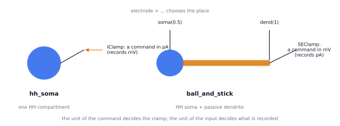
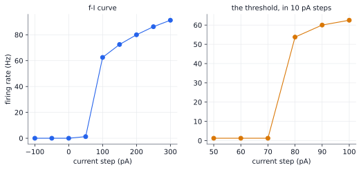
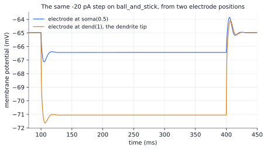
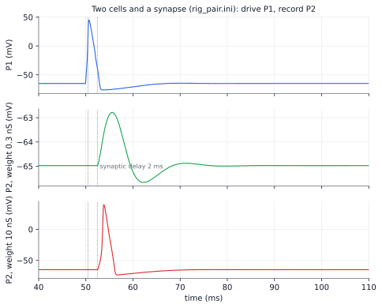
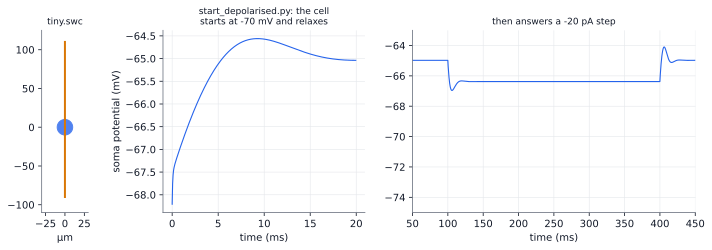
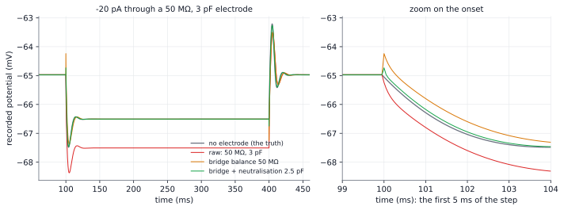
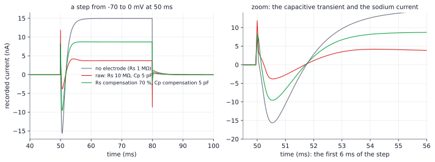
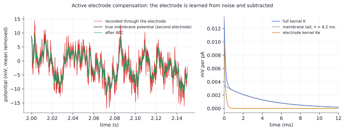

# 16. Tutorials with virtual cells

> **Status: built.** Every `$ ./lcg2 ...` line below is run by `make test` (when a Python with NEURON is available),
> and every number and figure comes from a real run on the NEURON backend, made with the files of
> [`examples/student_kit/`](../examples/student_kit/). The figures are drawn by
> [`docs/figures/make_neuron_figures.py`](figures/make_neuron_figures.py), which runs `lcg2` itself.
> The reference for all keys is [14 Virtual cells](14-neuron-models.md).

These eleven tutorials teach patch-clamp electrophysiology on cells that exist only in NEURON, and then how to put
**your own** cell on the rig. You do not need to know NEURON. The kit has everything.

**Before you start**

1. Build LCG2 (`make`). A Python that has NEURON and h5py: `pip install neuron h5py matplotlib`.
2. Make that Python the one LCG2 uses: activate the virtual environment (then `python3` is the right one, as the kit says), or
   `export LCG2_SIM_PYTHON=/path/to/that/python` (`which python3` in the environment), or edit `sim_python` in `rig.ini`.
3. Real runs write their files in the **current folder**. The commands below are run from the project folder, for
   brevity, so the files land there (git ignores them). In real use, make a data folder, `cd` into it, and give the
   full path to `lcg2` and to the kit.
4. To look at a recording: `python3 examples/student_kit/characterise.py ...` measures it, `plot_run.py` draws it,
   `examples/read_run.py` summarises it. In the commands below, `FILE.h5` is the data file your run printed.

| # | Tutorial | You learn |
|:--|:--|:--|
| A | [Your first cell](#a-your-first-cell-resting-potential-input-resistance-time-constant) | what is simulated; input resistance and time constant |
| B | [Excitability](#b-excitability-rheobase-and-the-f-i-curve) | rheobase, the f-I curve, a Hodgkin–Huxley neuron |
| C | [Voltage clamp](#c-voltage-clamp-and-the-i-v-curve) | inward and outward currents, the I-V curve |
| D | [Where you record](#d-where-the-electrode-is-soma-or-dendrite) | the electrode position matters |
| E | [Two cells and a synapse](#e-two-cells-and-a-synapse) | paired recordings, weights, delays |
| F | [Write your own cell](#f-write-your-own-cell-in-python) | a model in Python, step by step |
| G | [A morphology file](#g-a-cell-from-a-morphology-file-with-your-own-biophysics-and-initialisation) | SWC, biophysics, initialisation |
| H | [Your own channel](#h-your-own-channel-a-mod-file) | a `.mod` file: Ih and the sag |
| I | [Comparing cells, repeating runs](#i-comparing-cells-and-repeating-a-run) | profiles, batches, the run folder |
| J | [A real electrode](#j-a-real-electrode-bridge-balance-compensation-noise-and-aec) | pipette resistance and capacitance, bridge balance, neutralisation, series-resistance compensation, noise, active electrode compensation |
| K | [Seal, junction potential, bandwidth](#k-the-seal-the-junction-potential-and-the-amplifiers-bandwidth) | what a leaky seal, a junction offset and a filtered amplifier do to a recording |

---

## A. Your first cell: resting potential, input resistance, time constant

**Goal:** meet the default cell, and measure the two numbers every patch-clamp experiment starts with.



`rig.ini` is the configuration of a real rig (one pipette `P1`, with gains) plus the cell it is attached to:

```ini
[cell P1]
model = hh_soma          ; the default: a Hodgkin-Huxley soma (20 um)
```

A command in pA is a current clamp; the input in mV is the membrane potential. Look at what `-n` builds, then
play a small negative step (`small_step.sg`: 100 ms at rest, 300 ms at -20 pA, 300 ms at rest):

```console
$ ./lcg2 -c examples/student_kit/rig.ini -n examples/student_kit/small_step.sg
$ ./lcg2 -c examples/student_kit/rig.ini examples/student_kit/small_step.sg
```

```console
$ python3 examples/student_kit/characterise.py rin FILE.h5
step: -20 pA; potential -64.97 mV before, -66.51 mV at the end of the step
input resistance: 76.7 MOhm   (-1.53 mV / -20 pA)
membrane time constant: 0.7 ms   (the time to reach 63% of the change)
```


**Reading it.** The potential before the step is the resting potential (−65 mV). The steady change divided by the
current is the **input resistance**, Ohm's law: ΔV / ΔI = −1.53 mV / −20 pA = 77 MΩ. The time to reach 63 % of the
change is the **membrane time constant**, here under a millisecond because this soma is tiny (20 µm): a small cell
has little capacitance. The ringing at the start and end of the step is real: a Hodgkin–Huxley membrane is
resonant. (Rin is the *slope* at small currents; the measurement is only valid while the response is linear, so
use small steps.)

**Try.** A bigger cell has more membrane and a lower input resistance. The profile `big` doubles the diameter and
length of the soma:

```console
$ ./lcg2 -P big -c examples/student_kit/rig.ini examples/student_kit/small_step.sg
```

Measure it again: the input resistance falls from 77 to 17.5 MΩ. Which parameters can you change? Those of the
model, listed in [14](14-neuron-models.md#built-in) (`diam`, `length`, `gl`, ...). Add them to `[cell P1]` or to a
profile.

---

## B. Excitability: rheobase and the f-I curve

**Goal:** find the current at which the cell starts to fire, and how its rate grows.

`current_steps.sg` is a protocol: nine 800 ms steps from −100 to +300 pA, one trial every 2 seconds.

```console
$ ./lcg2 -c examples/student_kit/rig.ini examples/student_kit/current_steps.sg
```


```console
$ python3 examples/student_kit/characterise.py fi FILE.h5
step                spikes        Hz V at end, mV
amp=-100pA               0       0.0       -80.71
amp=-50pA                0       0.0       -69.83
amp=0pA                  0       0.0       -64.97
amp=50pA                 1       1.2       -62.26
amp=100pA               50      62.5       -65.21
amp=150pA               58      72.5       -57.10
...
first step with a spike: 50 pA
first step with repetitive firing (5 spikes or more): 100 pA
```

**Reading it.** At 50 pA the cell fires **once**, at the onset of the step, then stays silent: the potential
settles below threshold. At 100 pA it fires repetitively. A finer protocol shows where:

```console
$ ./lcg2 -c examples/student_kit/rig.ini examples/student_kit/current_steps_fine.sg
```



Repetitive firing starts at **80 pA**, and it starts at 54 Hz, not at a low rate: this is the abrupt onset of a
class II neuron, the Hodgkin–Huxley behaviour (a class I neuron's rate would grow smoothly from zero). Note also the
rebound spike at the end of the −100 pA step (anode-break excitation).

**Try.** `rig.sim_celsius = 22` (the profile `hot`) speeds up the channels: the rheobase moves.

```console
$ ./lcg2 -P hot -c examples/student_kit/rig.ini examples/student_kit/current_steps_fine.sg
```

Where is it now (it fires first at 100 pA)? Change `gnabar` (the sodium conductance) in `[cell P1]` and repeat.

---

## C. Voltage clamp and the I-V curve

**Goal:** see the currents behind the spikes.

`-m vc` switches the same rig to voltage clamp: the command is now in **mV** (a `SEClamp`) and the recording in
**pA**. `vc_steps.sg` holds at −70 mV and steps to −60 … +40 mV for 30 ms:

```console
$ ./lcg2 -m vc -c examples/student_kit/rig.ini examples/student_kit/vc_steps.sg
```


```console
$ python3 examples/student_kit/characterise.py iv FILE.h5
step             peak inward pA end of step pA
vm=-60mV                    -71            106
vm=-40mV                 -12377           2157
vm=-20mV                 -18450           7799
vm=0mV                   -15646          14954
vm=20mV                   -9741          22370
vm=40mV                   -2471          29744
```

**Reading it.** After the step there is a fast **inward** (negative) current, the sodium current, largest near
−20 mV and shrinking toward the sodium reversal potential (about +50 mV): the "peak inward" curve. A slower
**outward** (positive) current builds up, the potassium current, which grows with the voltage: the "end of the step"
curve. Inward is negative, as on a real amplifier. The tiny capacitive spike at the start and the end of each step
is the charging of the membrane through the electrode (`series_resistance`, 1 MΩ by default, in the `[cell]`).

**Try.** The input range clips what is too large and says so: change `gain_vc` in `rig.ini` to `1000` (so that 10 V is
10 nA) and play it again. The log reports the samples beyond the range, as a real digitiser would.

---

## D. Where the electrode is: soma or dendrite

**Goal:** see that a recording depends on where you place the electrode.

`ball_and_stick` is the soma with one passive dendrite. The `electrode` key says where the pipette is; the profile
`ballstick_dend` puts it at the dendrite's tip. The same −20 pA step, from the two places:

```console
$ ./lcg2 -P ballstick -c examples/student_kit/rig.ini examples/student_kit/small_step.sg
$ ./lcg2 -P ballstick_dend -c examples/student_kit/rig.ini examples/student_kit/small_step.sg
```



At the soma the input resistance is 73 MΩ; at the tip of the dendrite it is **304 MΩ**: a thin dendrite has
little membrane and a high resistance, so the same current produces a much larger voltage change. This is why real
recordings from dendrites differ from somatic ones. The picture of the models is at the top of tutorial A; the
place is written `section(position)`, for example `dend(1)` (the far end) or `soma(0.5)` (the middle).

---

## E. Two cells and a synapse

**Goal:** a paired recording: drive one cell, record the other.

`rig_pair.ini` has two cells, two pipettes and a synapse:

```ini
[cell P1]
model = hh_soma
[cell P2]
model = hh_soma

[synapse P1_P2]
pre    = P1
post   = P2
type   = exp2
tau1   = 0.5ms
tau2   = 3ms
weight = 0.0003          ; uS (0.3 nS)
delay  = 2ms
```

`pair_pulse.sg` gives P1 a 2 ms, 1.5 nA pulse (and nothing to P2):

```console
$ ./lcg2 -c examples/student_kit/rig_pair.ini examples/student_kit/pair_pulse.sg
$ ./lcg2 -P strong -c examples/student_kit/rig_pair.ini examples/student_kit/pair_pulse.sg
```



```console
$ python3 examples/student_kit/characterise.py psp FILE.h5
P1 fires at 50.45 ms
P2 rises 2.19 mV above its rest, peaking 5.15 ms after the spike
```

**Reading it.** P1 fires; two milliseconds later (the `delay`) P2 begins a depolarisation, a **postsynaptic
potential** of 2.2 mV peaking about 5 ms after the spike. With a thirty-fold stronger synapse (the profile `strong`,
10 nS) the PSP crosses threshold and P2 fires too. The profile changes one value: `synapse.P1_P2.weight`.
You patched both cells: that is what the second `[out]`/`[in]` pair is for. P2 receives no command (it is idle at its
rest value), which is why its trace is a pure response.

**Try.** Change `type = exp` with `tau = 5ms`; set `e = -80` (an inhibitory synapse: what happens to P2?);
add a third cell and a second synapse.

---

## F. Write your own cell in Python

**Goal:** make a cell that is not built in, with no NEURON knowledge beyond three lines.

LCG2 needs a file with a function `build(...)` that creates the cell and returns it. Everything else is yours.
[`two_compartment.py`](../examples/student_kit/two_compartment.py) is a soma and a dendrite; here it is in pieces.

**1. A section is a cylinder of membrane.** Give it a length and a diameter (micrometres), and the channels you want:

```python
from neuron import h

def build(soma_diam=20.0, dend_length=200.0, ...):
    cell = type("TwoCompartment", (), {"__str__": lambda self: "two_compartment"})()
    cell.soma = h.Section(name="soma", cell=cell)
    cell.soma.L = cell.soma.diam = soma_diam
    cell.soma.insert("hh")                      # Hodgkin-Huxley channels
```

**2. Add the dendrite and connect it.** `pas` is a passive membrane, just a leak:

```python
    cell.dend = h.Section(name="dend", cell=cell)
    cell.dend.L, cell.dend.diam, cell.dend.nseg = dend_length, dend_diam, 9
    cell.dend.insert("pas")
    cell.dend.connect(cell.soma(1))             # the dendrite starts at the end of the soma
    return cell
```

**3. Every argument of `build` can be set from the configuration.** The keys of `[cell]` that LCG2 does not use
itself are handed to `build` (numbers stay numbers). `rig_custom.ini` says:

```ini
[cell P1]
model       = two_compartment.py
dend_length = 200            ; um, a parameter of the model
```

A typo is caught: a key the function does not take is an error that lists the ones it takes. `nseg` is the number of
segments the section is divided into (more segments, more accurate, slower); 9 is plenty here.

```console
$ ./lcg2 -c examples/student_kit/rig_custom.ini -n examples/student_kit/small_step.sg
$ ./lcg2 -c examples/student_kit/rig_custom.ini examples/student_kit/small_step.sg
$ ./lcg2 -P short -c examples/student_kit/rig_custom.ini examples/student_kit/small_step.sg
$ ./lcg2 -P long -c examples/student_kit/rig_custom.ini examples/student_kit/small_step.sg
```


The profiles `short` (50 µm) and `long` (800 µm) change `dend_length`. A longer dendrite is more membrane in
parallel with the soma, so the input resistance falls: 75.6, 72.8 and 65.7 MΩ for 50, 200 and 800 µm. You made a
neuron and tested a hypothesis about it with three runs.

**Rules to remember.** Return the cell: an object whose attributes are the sections (`cell.soma`, `cell.dend`).
Create sections with `h.Section(name=..., cell=cell)`, so that two cells of the same model do not clash. The file
may also define a class `Cell`, or just create sections at its top level (then the file itself is the cell).
Where the electrode goes: `soma(0.5)` unless `[cell]` says `electrode = dend(1)` (the name is the attribute of
your cell). Errors in your file are shown with its name and the Python message.

---

## G. A cell from a morphology file, with your own biophysics and initialisation

**Goal:** use a reconstructed (SWC) morphology, put channels on it, and set its initial state.

A realistic workflow has three files, which LCG2 combines (`rig_morphology.ini`):

```ini
[cell P1]
morphology = tiny.swc
biophysics = cell_tuning.py
init       = start_depolarised.py
electrode  = soma(0.5)
```

* **`tiny.swc`** is the shape (SWC is the standard text format of neuron reconstructions: one line per point,
  with its type, position, radius and parent). Yours can come from a database such as NeuroMorpho.Org.
* **`cell_tuning.py`** says which channels go where. It is called with the cell, whose sections are `cell.soma`,
  `cell.dend`, `cell.apic`, `cell.axon` and the list `cell.all`:

  ```python
  def biophysics(cell, gnabar=0.12):
      for sec in cell.all:
          sec.Ra, sec.cm = 100, 1
          if sec == cell.soma:
              sec.insert("hh")
              sec.gnabar_hh = gnabar
          else:
              sec.insert("pas")
              sec.g_pas, sec.e_pas = 0.0001, -65
  ```

  (Compare sections with `==`, not `is`.) `gnabar` can be set from `[cell P1]` like any parameter.
* **`start_depolarised.py`** runs after the cell exists and has been initialised, so it can change the state: here it
  puts the soma at −70 mV.

  ```python
  def initialize(cell):
      for seg in cell.soma:
          seg.v = -70
  ```

```console
$ ./lcg2 -c examples/student_kit/rig_morphology.ini -n examples/student_kit/small_step.sg
$ ./lcg2 -c examples/student_kit/rig_morphology.ini examples/student_kit/small_step.sg
```



The recording starts at −70 mV and relaxes to rest in a few milliseconds (the init file at work: remove the line from
the configuration and it starts at rest), then answers the step. For a long relaxation, give the cell time before the
experiment with `sim_settle = 2s` in `[rig]` (see the next tutorial).

If you have no biophysics file, `biophysics = hh_soma` (HH in the soma, passive dendrites) or `passive` are built in.
The *d_lambda* rule chooses the number of segments of each section from its size (`d_lambda = 0.1`, change it or set 0
to keep the file's); the number of sections and segments is printed by `-n`. **hoc** works the same way: the
biophysics and init files define `proc biophysics()` / `proc initialize()`, which receive the cell's sections as `$o1`.

---

## H. Your own channel: a `.mod` file

**Goal:** add an ion channel that NEURON does not have, and see what it does.

Channels in NEURON are written in a small language, `.mod`. [`channels/ih.mod`](../examples/student_kit/channels/ih.mod)
is a hyperpolarisation-activated current (Ih): it opens when the cell is hyperpolarised and depolarises it. Its heart:

```text
BREAKPOINT {
    SOLVE states METHOD cnexp
    i = gbar * m * (v - e)            : current = conductance * gate * driving force
}
DERIVATIVE states {
    rates(v)
    m' = (minf - m) / tau             : the gate follows its target with time constant tau
}
```

Tell LCG2 where the `.mod` files are, and use the channel in a Python cell
([`soma_ih.py`](../examples/student_kit/soma_ih.py) does `soma.insert("ih")`); `rig_ih.ini`:

```ini
[rig]
sim_settle = 2s          ; Ih moves the true rest: let the cell reach it before the first trial
[cell P1]
model      = soma_ih.py
mechanisms = channels
gh         = 0.0005      ; S/cm2, a parameter of soma_ih.py
```

```console
$ ./lcg2 -c examples/student_kit/rig_ih.ini -n examples/student_kit/sag_step.sg
$ ./lcg2 -c examples/student_kit/rig_ih.ini examples/student_kit/sag_step.sg
$ ./lcg2 -P noih -c examples/student_kit/rig_ih.ini examples/student_kit/sag_step.sg
```

The first time, LCG2 compiles the `.mod` file by itself (with `nrnivmodl`) into a cache folder, never into yours; this
takes a few seconds to a minute, and the next runs reuse it (a change to the file recompiles it).


```console
$ python3 examples/student_kit/characterise.py sag FILE.h5
step: -100 pA; baseline -62.86 mV
peak -72.04 mV (-9.18 mV from the baseline), steady state -67.20 mV (-4.34 mV)
sag ratio: 2.12   (1.00 is no sag; larger means the potential sags back)
```

With Ih the potential dips by 9.2 mV and **sags back** to −4.3 mV from the baseline as the channels open (sag ratio
2.1); without it (`-P noih`, `gh = 0`) it stays at −15.7 mV (sag ratio 1.00). The channel also depolarises the
resting potential by two millivolts (−62.9 against −65.0 mV), which is why `sim_settle` is in the file: without it the
first trial would begin before the cell had reached its rest.

**Try.** Change `gh`; change the half-activation voltage in `rates()` of `ih.mod` (the file is recompiled by itself);
make a channel of your own from `slowleak.mod` in `examples/models/mod/`.

---

## I. Comparing cells, and repeating a run

**Goal:** compare models fairly, run batches, and reproduce a result.

**Comparing.** One rig, one stimulus, four cells, chosen by a profile each: the models of `rig.ini` are built in
(`hh_soma`, `ball_and_stick`), written in Python (`pyramidal.py`) and written in hoc (`simple_cell.hoc`).

```console
$ ./lcg2 -P ballstick -c examples/student_kit/rig.ini examples/student_kit/current_steps.sg
$ ./lcg2 -P pyramidal -c examples/student_kit/rig.ini examples/student_kit/current_steps.sg
$ ./lcg2 -P hoc -c examples/student_kit/rig.ini examples/student_kit/current_steps.sg
```


**Batches.** Each run writes its own file, named from the time. A shell loop makes a parameter study:

```text
for p in big hot ballstick; do lcg2 -P $p -c rig.ini small_step.sg; sleep 1; done
for f in 2026*.h5; do python3 characterise.py rin $f; done
```

(`sleep 1` because two runs in the same second get a `-2` suffix; they are still separate.)

**Reproducing.** Every run leaves the hidden folder `.STEM/` next to its data file: the resolved configuration
(`config.ini`), the command (`command.txt`), the stimulus, the NEURON network as it was built (`network.json`),
**copies of every model file that was read** (`files/`), the NEURON log (`neuron.log`) and the SHA-256 of all of it.
Give the folder with the data and anyone can see exactly which cell, which parameters and which version produced it,
and `shasum -a 256 -c .STEM/SHA256SUMS` proves nothing changed. See [13 Data format](13-data-format.md).

**Plot it.** `python3 examples/student_kit/plot_run.py FILE.h5 3` draws trial 3 (the command and the recording);
add a file name to save it (`... 3 out.svg`).

---

## J. A real electrode: bridge balance, compensation, noise, and AEC

**Goal:** record through a pipette that is not ideal, see the artefacts it adds, and correct them as you would on a
rig: bridge balance and capacitance neutralisation in current clamp, series-resistance and pipette-capacitance
compensation in voltage clamp, and finally **active electrode compensation** (AEC) done on the recording afterwards.

Until now the electrode was ideal. A real pipette has a resistance and a capacitance, and every number it adds is in the
recording ([14](14-neuron-models.md#the-pipette-and-the-amplifier) has the circuits and the equations):


`rig_electrode.ini` gives the cell a 50 MΩ, 3 pF pipette (`electrode_resistance`, `electrode_capacitance`) and has profiles
for each correction. The amplifier settings are part of the configuration, as on a rig they are knobs you set before
the experiment: you change them with a profile on the command line (they are fixed during a run).

### J1. Current clamp: the voltage drop across the electrode

The same −20 pA step as in tutorial A, with no electrode (the truth), through the raw electrode, with the bridge balanced
at 50 MΩ, and with the capacitance also neutralised:

```console
$ ./lcg2 -P ideal -c examples/student_kit/rig_electrode.ini examples/student_kit/small_step.sg
$ ./lcg2 -P raw -c examples/student_kit/rig_electrode.ini examples/student_kit/small_step.sg
$ ./lcg2 -P bridge -c examples/student_kit/rig_electrode.ini examples/student_kit/small_step.sg
$ ./lcg2 -P balanced -c examples/student_kit/rig_electrode.ini examples/student_kit/small_step.sg
```



**Raw.** The recording sits **1.000 mV** below the truth for the whole step: that is Ohm's law, −20 pA × 50 MΩ, the voltage
drop of the injected current across the electrode. A recording of the cell this way is wrong by exactly what you inject,
and the error changes with every current.
**Bridge balance.** The amplifier knows the current it injects, so it subtracts `Rb × I`. With `bridge_balance = 50`, equal to
the electrode, the steady level is exactly the truth (the difference is below a microvolt in the simulation). On a real rig
you adjust the knob until the sudden jump at the beginning and the end of a step disappears.
**But** look at the right-hand panel, the first 5 ms: the jump is removed immediately, while the electrode node follows only
slowly, charging the pipette capacitance through the resistance, so the bridge-balanced trace *overshoots* at the onset
(0.81 mV off the truth, worse than raw, 0.55 mV, in the first two milliseconds).
**Capacitance neutralisation** is the second knob: the amplifier feeds back positive current that cancels most of the
pipette capacitance (`cap_neutralization = 2.5` of the 3 pF). The onset error falls to 0.32 mV. Push it to 3 pF or more and
the amplifier would oscillate, as a real one does; LCG2 refuses such a setting.

### J2. Noise

`recording_noise` adds white Gaussian noise (rms, in the unit of the recording, mV in current clamp, pA in voltage clamp):

```console
$ ./lcg2 -P noisy -c examples/student_kit/rig_electrode.ini examples/student_kit/small_step.sg
```

The profile `noisy` asks for 0.3 mV rms and the recording has 0.305 mV. The noise is the same every time you repeat the run
(`noise_seed`; give another to get another sample), and it goes on from one trial to the next, so trials differ. Measure the
resting noise in the first 100 ms and the signal-to-noise of a small step: how large a PSP can you see?

### J3. Voltage clamp: series resistance and the pipette capacitance

In voltage clamp the electrode's resistance is the series resistance Rs between the amplifier and the cell: the cell does not
see the command, it sees the command minus Rs × I. The vc profiles use a 10 MΩ electrode with 5 pF of pipette capacitance and the
step to 0 mV of tutorial C:

```console
$ ./lcg2 -m vc -P ideal -c examples/student_kit/rig_electrode.ini examples/student_kit/vc_steps.sg
$ ./lcg2 -m vc -P vc_raw -c examples/student_kit/rig_electrode.ini examples/student_kit/vc_steps.sg
$ ./lcg2 -m vc -P vc_comp -c examples/student_kit/rig_electrode.ini examples/student_kit/vc_steps.sg
```



**Raw.** The large sodium current (15 nA at the peak in the ideal case) would drop 150 mV across 10 MΩ, twice the 70 mV step: the
cell is not clamped, so the recorded peak is only −3.8 nA instead of −15.6 nA, and the steady current is 3.7 nA instead of
14.9 nA. This is the textbook reason for keeping Rs small and for reading the currents of large cells with suspicion. The
first sample also holds the capacitive transient of the **pipette** (5 pF × 70 mV in one sample), which is not the cell's:
11.9 nA against 8.1 nA.
**Compensated.** `rs_compensation = 70` feeds back 70 % of `Rs × I`: the peak recovers to −9.6 nA and the steady current to
8.7 nA, and `cp_compensation = 5` subtracts the pipette transient (first sample 8.3 nA, back to the cell's own). Compensation
cannot be 100 %: positive feedback of that size is unstable, so LCG2 refuses it; and the usual rule applies: a
compensation that is too large rings.

### J4. Active electrode compensation, offline

Instead of balancing knobs, **learn the electrode** from the recording itself and subtract it. The method of Brette et al.
(2008): inject a broadband noise current; the recorded potential is linear in the current, `V = K * I`; the kernel K is the sum of
a slow membrane part (an exponential for a passive cell) and a fast electrode part; fit the slow tail and what is left is the
electrode kernel Ke; then `Vm = V − Ke * I`, for this recording and for any other made through the same electrode.

`rig_aec.ini` has a **passive** cell (no voltage-gated channels, so one time constant), the same bad electrode, and, with `same_as`,
a **second, ideal electrode on the same cell** (`V0`) that records the true membrane potential: something a real experiment
never has, so that you can judge the result. A fixed seed (`-s 5`) makes the noise stimulus repeatable:

```console
$ ./lcg2 -s 5 -c examples/student_kit/rig_aec.ini examples/student_kit/aec_noise.sg
```

```console
$ python3 examples/student_kit/aec.py FILE.h5
estimated membrane time constant: 4.17 ms
electrode kernel: peak 0.010 mV/pA at 0.00 ms; the electrode contributes 2.07 mV rms to the recording
error against the true membrane potential (V0): 2.661 mV rms before, 0.606 mV rms after (4x better)
```



The recording through the electrode (red) differs from the true potential (grey) by 2.7 mV rms; after AEC (green) by 0.6 mV rms:
four times closer. The right panel shows the three kernels: the full one, the membrane's exponential tail (τ = 4.2 ms), and the
electrode's, which lasts under a millisecond. Not perfect (0.6 mV is left), because the cell does not receive exactly the
command through a capacitive electrode, and the kernel is an estimate from noise. **Try:** `-P ideal` has no electrode (AEC
then finds nothing to remove); change `electrode_resistance`, give the cell `gnabar = 0.12` again and see why AEC is described
for subthreshold recordings (a spiking cell is not linear).

**Where this stops.** LCG2 simulates a lumped pipette and a first-order amplifier; there is no whole-cell capacitance compensation, and
the compensations are settings, not an interactive knob during a run. The seal, the junction potential and the bandwidth are tutorial K. The list is in [14](14-neuron-models.md#limits-what-this-does-not-do).

---

## K. The seal, the junction potential and the amplifier's bandwidth

**Goal:** three more things that make a real recording differ from the cell: the leak around the pipette, the offset between the
solutions, and the filter in the amplifier. All three are `[cell]` keys (the same pipette keys as tutorial J); the profiles are in
`rig_electrode.ini`.


### K1. The seal leaks

A seal of several gigaohms is never infinite. `seal_resistance` (in GΩ) lets current leak from the inside of the cell to the bath
(0 mV), which for a cell resting at −65 mV is a steady **depolarising** current. The same −20 pA step as before, with an ideal
electrode so that only the seal differs, after one second of settling (`sim_settle`) so that the cell has reached its new rest:

```console
$ ./lcg2 -P ideal -c examples/student_kit/rig_electrode.ini examples/student_kit/small_step.sg
$ ./lcg2 -P seal2g -c examples/student_kit/rig_electrode.ini examples/student_kit/small_step.sg
$ ./lcg2 -P seal1g -c examples/student_kit/rig_electrode.ini examples/student_kit/small_step.sg
```

The resting potential moves from −65.0 mV to −63.1 mV with a 2 GΩ seal and to −61.8 mV with 1 GΩ, and the input resistance
measured from the step falls from 77 to 54 and to 42 MΩ: a leaky seal both **depolarises** the cell and **lowers** its resistance, two
things you read as a sick cell. (The fall is larger than the 7 % that 1 GΩ in parallel with 77 MΩ would give, because the cell is
non-linear: depolarised, it conducts more.) Try `seal_resistance = 0.5`: this small cell is pushed over threshold and fires on its own.
In voltage clamp the leak is a standing current the amplifier supplies:

```console
$ ./lcg2 -m vc -P vc_raw -c examples/student_kit/rig_electrode.ini examples/student_kit/vc_steps.sg
$ ./lcg2 -m vc -P vc_seal -c examples/student_kit/rig_electrode.ini examples/student_kit/vc_steps.sg
```

At −70 mV the 500 MΩ seal of `vc_seal` adds about −70 mV / 500 MΩ = −140 pA to the holding current (−122 pA in the recording): this is
the usual reason to discard a cell whose holding current drifts. A seal too leaky for the time step is refused with the smallest
value that is accepted.

### K2. The liquid junction potential

The pipette solution and the bath differ, which adds a constant potential between them: what you record is the cell's potential plus
that offset. `liquid_junction_potential = 10` makes the recording read 10 mV more positive than the cell really is, all the time:

```console
$ ./lcg2 -P junction -c examples/student_kit/rig_electrode.ini examples/student_kit/small_step.sg
```

The trace is the ideal one raised by exactly 10 mV (the test checks that to a nanovolt). In voltage clamp it works the other way: a
command of −60 mV puts the cell at −70 mV, so the currents you record are those of a cell 10 mV more hyperpolarised than the number you
typed. Nothing corrects this automatically, as on a rig: you subtract the junction potential from every potential you report, or
correct the command.

### K3. The amplifier's bandwidth

An amplifier filters its output (a 4-pole Bessel low-pass, typically 2 to 10 kHz) before the digitiser. `amplifier_bandwidth` gives its
−3 dB corner in kHz. In voltage clamp, the pipette's capacitive transient is one very fast spike, which the filter rounds off:

```console
$ ./lcg2 -m vc -P vc_bandwidth -c examples/student_kit/rig_electrode.ini examples/student_kit/vc_steps.sg
```

In the right-hand panel of the figure the unfiltered spike of 11.7 nA in the first sample is cut to 0.1 nA, and the sodium current
that follows (a few milliseconds) passes almost unchanged: the filter keeps what is slow and removes what is fast. The choice of corner
is the usual compromise: low enough to remove noise, high enough not to distort the signal you care about (a spike at 1 ms needs
several kHz). The filter is a real 4-pole Bessel (gain 0.71 at the corner, 0.20 at twice the corner, to within 1 %), and it is
accurate while the corner times `sim_dt` is at most 0.1: for 10 kHz set `sim_dt = 10us` in `[rig]`, and the program says so if you forget.

**Try.** Put `recording_noise` and `amplifier_bandwidth` together and see how the filter reduces the noise (white noise sampled at
20 kHz loses power in proportion to the bandwidth); give the electrode a resistance and measure how the bridge-balanced onset of tutorial J
changes with the filter; correct the potentials of a junction-offset recording by hand.

---

## What to do when something goes wrong

* `lcg2 -n` builds the cells without playing anything: run it first, it finds nearly every mistake in a model file.
* Messages name the file and the key; the table of messages is in [14](14-neuron-models.md#when-it-goes-wrong).
* A model that crashes leaves its Python traceback in `.STEM/neuron.log`.
* `python3 neuron/lcg2_neuron.py --check rig.ini` builds the cells of a configuration with no LCG2 run at all.
* A spike clipped flat at the top of a recording is the input **range** at work (a warning says so): raise `range` of
  `[in P1]`, or the gain.

The limits of the simulation (one electrode per cell, no electrode capacitance, no noise) are listed in
[14](14-neuron-models.md#limits-what-this-does-not-do).
