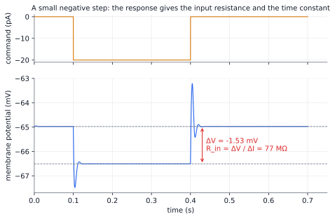
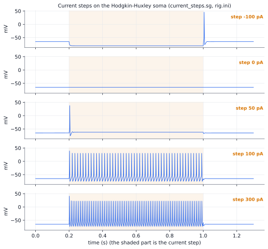
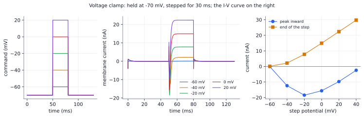
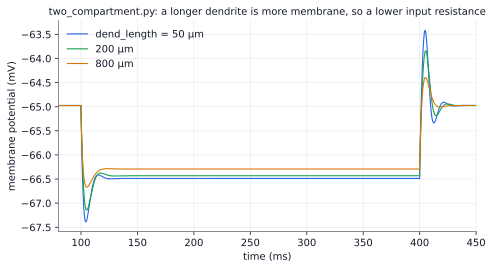
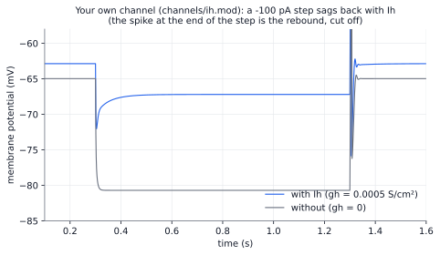
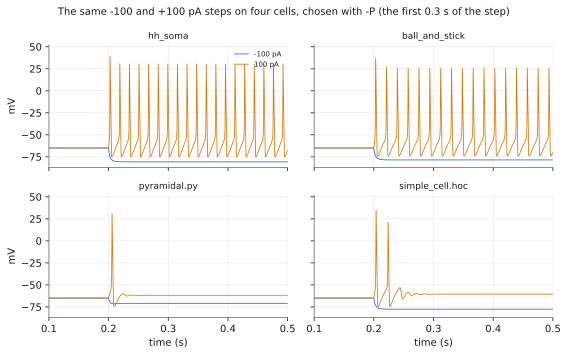

# 16. Tutorials with virtual cells

> **Status: built.** Every `$ ./lcg2 ...` line below is run by `make test` (when a Python with NEURON is available),
> and every number and figure comes from a real run on the NEURON backend, made with the files of
> [`examples/student_kit/`](../examples/student_kit/). The figures are drawn by
> [`docs/figures/make_neuron_figures.py`](figures/make_neuron_figures.py), which runs `lcg2` itself.
> The reference for all keys is [14 Virtual cells](14-neuron-models.md).

These tutorials teach patch-clamp electrophysiology on cells that exist only in NEURON, and then how to put
**your own** cell on the rig. You do not need to know NEURON. The kit has everything.

**Before you start**

1. Build LCG2 (`make`). A Python that has NEURON and h5py: `pip install neuron h5py matplotlib`.
2. Open `examples/student_kit/rig.ini` and set `sim_python` to that Python (`which python3`).
3. Real runs write their files in the **current folder**. The commands below are run from the project folder, for
   brevity, so the files land there (git ignores them). In real use, make a data folder, `cd` into it, and give the
   full path to `lcg2` and to the kit.
4. To look at a recording: `python3 examples/student_kit/characterise.py ...` measures it, `plot_run.py` draws it,
   `examples/read_run.py` summarises it. In the commands below, `FILE.h5` is the data file your run printed.

| # | Tutorial | You learn |
|:--|:--|:--|
| A | [Your first cell](#a-your-first-cell-resting-potential-input-resistance-time-constant) | what is simulated; input resistance and time constant |
| B | [Excitability](#b-excitability-rheobase-and-the-f-i-curve) | rheobase, the f-I curve, a Hodgkin–Huxley neuron |
| C | [Voltage clamp](#c-voltage-clamp-and-the-i-v-curve) | inward and outward currents, the I-V curve |
| D | [Where you record](#d-where-the-electrode-is-soma-or-dendrite) | the electrode position matters |
| E | [Two cells and a synapse](#e-two-cells-and-a-synapse) | paired recordings, weights, delays |
| F | [Write your own cell](#f-write-your-own-cell-in-python) | a model in Python, step by step |
| G | [A morphology file](#g-a-cell-from-a-morphology-file-with-your-own-biophysics-and-initialisation) | SWC, biophysics, initialisation |
| H | [Your own channel](#h-your-own-channel-a-mod-file) | a `.mod` file: Ih and the sag |
| I | [Comparing cells, repeating runs](#i-comparing-cells-and-repeating-a-run) | profiles, batches, the run folder |

---

## A. Your first cell: resting potential, input resistance, time constant

**Goal:** meet the default cell, and measure the two numbers every patch-clamp experiment starts with.


`rig.ini` is the configuration of a real rig (one pipette `P1`, with gains) plus the cell it is attached to:

```ini
[cell P1]
model = hh_soma          ; the default: a Hodgkin-Huxley soma (20 um)
```

A command in pA is a current clamp; the input in mV is the membrane potential. Look at what `-n` builds, then
play a small negative step (`small_step.sg`: 100 ms at rest, 300 ms at -20 pA, 300 ms at rest):

```console
$ ./lcg2 -c examples/student_kit/rig.ini -n examples/student_kit/small_step.sg
$ ./lcg2 -c examples/student_kit/rig.ini examples/student_kit/small_step.sg
```

```console
$ python3 examples/student_kit/characterise.py rin FILE.h5
step: -20 pA; potential -64.97 mV before, -66.51 mV at the end of the step
input resistance: 76.7 MOhm   (-1.53 mV / -20 pA)
membrane time constant: 0.7 ms   (the time to reach 63% of the change)
```



**Reading it.** The potential before the step is the resting potential (−65 mV). The steady change divided by the
current is the **input resistance**, Ohm's law: ΔV / ΔI = −1.53 mV / −20 pA = 77 MΩ. The time to reach 63 % of the
change is the **membrane time constant**, here under a millisecond because this soma is tiny (20 µm): a small cell
has little capacitance. The ringing at the start and end of the step is real: a Hodgkin–Huxley membrane is
resonant. (Rin is the *slope* at small currents; the measurement is only valid while the response is linear, so
use small steps.)

**Try.** A bigger cell has more membrane and a lower input resistance. The profile `big` doubles the diameter and
length of the soma:

```console
$ ./lcg2 -P big -c examples/student_kit/rig.ini examples/student_kit/small_step.sg
```

Measure it again: the input resistance falls from 77 to 17.5 MΩ. Which parameters can you change? Those of the
model, listed in [14](14-neuron-models.md#built-in) (`diam`, `length`, `gl`, ...). Add them to `[cell P1]` or to a
profile.

---

## B. Excitability: rheobase and the f-I curve

**Goal:** find the current at which the cell starts to fire, and how its rate grows.

`current_steps.sg` is a protocol: nine 800 ms steps from −100 to +300 pA, one trial every 2 seconds.

```console
$ ./lcg2 -c examples/student_kit/rig.ini examples/student_kit/current_steps.sg
```



```console
$ python3 examples/student_kit/characterise.py fi FILE.h5
step                spikes        Hz V at end, mV
amp=-100pA               0       0.0       -80.71
amp=-50pA                0       0.0       -69.83
amp=0pA                  0       0.0       -64.97
amp=50pA                 1       1.2       -62.26
amp=100pA               50      62.5       -65.21
amp=150pA               58      72.5       -57.10
...
first step with a spike: 50 pA
first step with repetitive firing (5 spikes or more): 100 pA
```

**Reading it.** At 50 pA the cell fires **once**, at the onset of the step, then stays silent: the potential
settles below threshold. At 100 pA it fires repetitively. A finer protocol shows where:

```console
$ ./lcg2 -c examples/student_kit/rig.ini examples/student_kit/current_steps_fine.sg
```


Repetitive firing starts at **80 pA**, and it starts at 54 Hz, not at a low rate: this is the abrupt onset of a
class II neuron, the Hodgkin–Huxley behaviour (a class I neuron's rate would grow smoothly from zero). Note also the
rebound spike at the end of the −100 pA step (anode-break excitation).

**Try.** `rig.sim_celsius = 22` (the profile `hot`) speeds up the channels: the rheobase moves.

```console
$ ./lcg2 -P hot -c examples/student_kit/rig.ini examples/student_kit/current_steps_fine.sg
```

Where is it now (it fires first at 100 pA)? Change `gnabar` (the sodium conductance) in `[cell P1]` and repeat.

---

## C. Voltage clamp and the I-V curve

**Goal:** see the currents behind the spikes.

`-m vc` switches the same rig to voltage clamp: the command is now in **mV** (a `SEClamp`) and the recording in
**pA**. `vc_steps.sg` holds at −70 mV and steps to −60 … +40 mV for 30 ms:

```console
$ ./lcg2 -m vc -c examples/student_kit/rig.ini examples/student_kit/vc_steps.sg
```



```console
$ python3 examples/student_kit/characterise.py iv FILE.h5
step             peak inward pA end of step pA
vm=-60mV                    -71            106
vm=-40mV                 -12377           2157
vm=-20mV                 -18450           7799
vm=0mV                   -15646          14954
vm=20mV                   -9741          22370
vm=40mV                   -2471          29744
```

**Reading it.** After the step there is a fast **inward** (negative) current, the sodium current, largest near
−20 mV and shrinking toward the sodium reversal potential (about +50 mV): the "peak inward" curve. A slower
**outward** (positive) current builds up, the potassium current, which grows with the voltage: the "end of the step"
curve. Inward is negative, as on a real amplifier. The tiny capacitive spike at the start and the end of each step
is the charging of the membrane through the electrode (`series_resistance`, 1 MΩ by default, in the `[cell]`).

**Try.** The input range clips what is too large and says so: change `gain_vc` in `rig.ini` to `1000` (so that 10 V is
10 nA) and play it again. The log reports the samples beyond the range, as a real digitiser would.

---

## D. Where the electrode is: soma or dendrite

**Goal:** see that a recording depends on where you place the electrode.

`ball_and_stick` is the soma with one passive dendrite. The `electrode` key says where the pipette is; the profile
`ballstick_dend` puts it at the dendrite's tip. The same −20 pA step, from the two places:

```console
$ ./lcg2 -P ballstick -c examples/student_kit/rig.ini examples/student_kit/small_step.sg
$ ./lcg2 -P ballstick_dend -c examples/student_kit/rig.ini examples/student_kit/small_step.sg
```


At the soma the input resistance is 73 MΩ; at the tip of the dendrite it is **304 MΩ**: a thin dendrite has
little membrane and a high resistance, so the same current produces a much larger voltage change. This is why real
recordings from dendrites differ from somatic ones. The picture of the models is at the top of tutorial A; the
place is written `section(position)`, for example `dend(1)` (the far end) or `soma(0.5)` (the middle).

---

## E. Two cells and a synapse

**Goal:** a paired recording: drive one cell, record the other.

`rig_pair.ini` has two cells, two pipettes and a synapse:

```ini
[cell P1]
model = hh_soma
[cell P2]
model = hh_soma

[synapse P1_P2]
pre    = P1
post   = P2
type   = exp2
tau1   = 0.5ms
tau2   = 3ms
weight = 0.0003          ; uS (0.3 nS)
delay  = 2ms
```

`pair_pulse.sg` gives P1 a 2 ms, 1.5 nA pulse (and nothing to P2):

```console
$ ./lcg2 -c examples/student_kit/rig_pair.ini examples/student_kit/pair_pulse.sg
$ ./lcg2 -P strong -c examples/student_kit/rig_pair.ini examples/student_kit/pair_pulse.sg
```


```console
$ python3 examples/student_kit/characterise.py psp FILE.h5
P1 fires at 50.45 ms
P2 rises 2.19 mV above its rest, peaking 5.15 ms after the spike
```

**Reading it.** P1 fires; two milliseconds later (the `delay`) P2 begins a depolarisation, a **postsynaptic
potential** of 2.2 mV peaking about 5 ms after the spike. With a thirty-fold stronger synapse (the profile `strong`,
10 nS) the PSP crosses threshold and P2 fires too. The profile changes one value: `synapse.P1_P2.weight`.
You patched both cells: that is what the second `[out]`/`[in]` pair is for. P2 receives no command (it is idle at its
rest value), which is why its trace is a pure response.

**Try.** Change `type = exp` with `tau = 5ms`; set `e = -80` (an inhibitory synapse: what happens to P2?);
add a third cell and a second synapse.

---

## F. Write your own cell in Python

**Goal:** make a cell that is not built in, with no NEURON knowledge beyond three lines.

LCG2 needs a file with a function `build(...)` that creates the cell and returns it. Everything else is yours.
[`two_compartment.py`](../examples/student_kit/two_compartment.py) is a soma and a dendrite; here it is in pieces.

**1. A section is a cylinder of membrane.** Give it a length and a diameter (micrometres), and the channels you want:

```python
from neuron import h

def build(soma_diam=20.0, dend_length=200.0, ...):
    cell = type("TwoCompartment", (), {"__str__": lambda self: "two_compartment"})()
    cell.soma = h.Section(name="soma", cell=cell)
    cell.soma.L = cell.soma.diam = soma_diam
    cell.soma.insert("hh")                      # Hodgkin-Huxley channels
```

**2. Add the dendrite and connect it.** `pas` is a passive membrane, just a leak:

```python
    cell.dend = h.Section(name="dend", cell=cell)
    cell.dend.L, cell.dend.diam, cell.dend.nseg = dend_length, dend_diam, 9
    cell.dend.insert("pas")
    cell.dend.connect(cell.soma(1))             # the dendrite starts at the end of the soma
    return cell
```

**3. Every argument of `build` can be set from the configuration.** The keys of `[cell]` that LCG2 does not use
itself are handed to `build` (numbers stay numbers). `rig_custom.ini` says:

```ini
[cell P1]
model       = two_compartment.py
dend_length = 200            ; um, a parameter of the model
```

A typo is caught: a key the function does not take is an error that lists the ones it takes. `nseg` is the number of
segments the section is divided into (more segments, more accurate, slower); 9 is plenty here.

```console
$ ./lcg2 -c examples/student_kit/rig_custom.ini -n examples/student_kit/small_step.sg
$ ./lcg2 -c examples/student_kit/rig_custom.ini examples/student_kit/small_step.sg
$ ./lcg2 -P short -c examples/student_kit/rig_custom.ini examples/student_kit/small_step.sg
$ ./lcg2 -P long -c examples/student_kit/rig_custom.ini examples/student_kit/small_step.sg
```



The profiles `short` (50 µm) and `long` (800 µm) change `dend_length`. A longer dendrite is more membrane in
parallel with the soma, so the input resistance falls: 75.6, 72.8 and 65.7 MΩ for 50, 200 and 800 µm. You made a
neuron and tested a hypothesis about it with three runs.

**Rules to remember.** Return the cell: an object whose attributes are the sections (`cell.soma`, `cell.dend`).
Create sections with `h.Section(name=..., cell=cell)`, so that two cells of the same model do not clash. The file
may also define a class `Cell`, or just create sections at its top level (then the file itself is the cell).
Where the electrode goes: `soma(0.5)` unless `[cell]` says `electrode = dend(1)` (the name is the attribute of
your cell). Errors in your file are shown with its name and the Python message.

---

## G. A cell from a morphology file, with your own biophysics and initialisation

**Goal:** use a reconstructed (SWC) morphology, put channels on it, and set its initial state.

A realistic workflow has three files, which LCG2 combines (`rig_morphology.ini`):

```ini
[cell P1]
morphology = tiny.swc
biophysics = cell_tuning.py
init       = start_depolarised.py
electrode  = soma(0.5)
```

* **`tiny.swc`** is the shape (SWC is the standard text format of neuron reconstructions: one line per point,
  with its type, position, radius and parent). Yours can come from a database such as NeuroMorpho.Org.
* **`cell_tuning.py`** says which channels go where. It is called with the cell, whose sections are `cell.soma`,
  `cell.dend`, `cell.apic`, `cell.axon` and the list `cell.all`:

  ```python
  def biophysics(cell, gnabar=0.12):
      for sec in cell.all:
          sec.Ra, sec.cm = 100, 1
          if sec == cell.soma:
              sec.insert("hh")
              sec.gnabar_hh = gnabar
          else:
              sec.insert("pas")
              sec.g_pas, sec.e_pas = 0.0001, -65
  ```

  (Compare sections with `==`, not `is`.) `gnabar` can be set from `[cell P1]` like any parameter.
* **`start_depolarised.py`** runs after the cell exists and has been initialised, so it can change the state: here it
  puts the soma at −70 mV.

  ```python
  def initialize(cell):
      for seg in cell.soma:
          seg.v = -70
  ```

```console
$ ./lcg2 -c examples/student_kit/rig_morphology.ini -n examples/student_kit/small_step.sg
$ ./lcg2 -c examples/student_kit/rig_morphology.ini examples/student_kit/small_step.sg
```


The recording starts at −70 mV and relaxes to rest in a few milliseconds (the init file at work: remove the line from
the configuration and it starts at rest), then answers the step. For a long relaxation, give the cell time before the
experiment with `sim_settle = 2s` in `[rig]` (see the next tutorial).

If you have no biophysics file, `biophysics = hh_soma` (HH in the soma, passive dendrites) or `passive` are built in.
The *d_lambda* rule chooses the number of segments of each section from its size (`d_lambda = 0.1`, change it or set 0
to keep the file's); the number of sections and segments is printed by `-n`. **hoc** works the same way: the
biophysics and init files define `proc biophysics()` / `proc initialize()`, which receive the cell's sections as `$o1`.

---

## H. Your own channel: a `.mod` file

**Goal:** add an ion channel that NEURON does not have, and see what it does.

Channels in NEURON are written in a small language, `.mod`. [`channels/ih.mod`](../examples/student_kit/channels/ih.mod)
is a hyperpolarisation-activated current (Ih): it opens when the cell is hyperpolarised and depolarises it. Its heart:

```text
BREAKPOINT {
    SOLVE states METHOD cnexp
    i = gbar * m * (v - e)            : current = conductance * gate * driving force
}
DERIVATIVE states {
    rates(v)
    m' = (minf - m) / tau             : the gate follows its target with time constant tau
}
```

Tell LCG2 where the `.mod` files are, and use the channel in a Python cell
([`soma_ih.py`](../examples/student_kit/soma_ih.py) does `soma.insert("ih")`); `rig_ih.ini`:

```ini
[rig]
sim_settle = 2s          ; Ih moves the true rest: let the cell reach it before the first trial
[cell P1]
model      = soma_ih.py
mechanisms = channels
gh         = 0.0005      ; S/cm2, a parameter of soma_ih.py
```

```console
$ ./lcg2 -c examples/student_kit/rig_ih.ini -n examples/student_kit/sag_step.sg
$ ./lcg2 -c examples/student_kit/rig_ih.ini examples/student_kit/sag_step.sg
$ ./lcg2 -P noih -c examples/student_kit/rig_ih.ini examples/student_kit/sag_step.sg
```

The first time, LCG2 compiles the `.mod` file by itself (with `nrnivmodl`) into a cache folder, never into yours; this
takes a few seconds to a minute, and the next runs reuse it (a change to the file recompiles it).



```console
$ python3 examples/student_kit/characterise.py sag FILE.h5
step: -100 pA; baseline -62.86 mV
peak -72.04 mV (-9.18 mV from the baseline), steady state -67.20 mV (-4.34 mV)
sag ratio: 2.12   (1.00 is no sag; larger means the potential sags back)
```

With Ih the potential dips by 9.2 mV and **sags back** to −4.3 mV from the baseline as the channels open (sag ratio
2.1); without it (`-P noih`, `gh = 0`) it stays at −15.7 mV (sag ratio 1.00). The channel also depolarises the
resting potential by two millivolts (−62.9 against −65.0 mV), which is why `sim_settle` is in the file: without it the
first trial would begin before the cell had reached its rest.

**Try.** Change `gh`; change the half-activation voltage in `rates()` of `ih.mod` (the file is recompiled by itself);
make a channel of your own from `slowleak.mod` in `examples/models/mod/`.

---

## I. Comparing cells, and repeating a run

**Goal:** compare models fairly, run batches, and reproduce a result.

**Comparing.** One rig, one stimulus, four cells, chosen by a profile each: the models of `rig.ini` are built in
(`hh_soma`, `ball_and_stick`), written in Python (`pyramidal.py`) and written in hoc (`simple_cell.hoc`).

```console
$ ./lcg2 -P ballstick -c examples/student_kit/rig.ini examples/student_kit/current_steps.sg
$ ./lcg2 -P pyramidal -c examples/student_kit/rig.ini examples/student_kit/current_steps.sg
$ ./lcg2 -P hoc -c examples/student_kit/rig.ini examples/student_kit/current_steps.sg
```



**Batches.** Each run writes its own file, named from the time. A shell loop makes a parameter study:

```text
for p in big hot ballstick; do lcg2 -P $p -c rig.ini small_step.sg; sleep 1; done
for f in 2026*.h5; do python3 characterise.py rin $f; done
```

(`sleep 1` because two runs in the same second get a `-2` suffix; they are still separate.)

**Reproducing.** Every run leaves the hidden folder `.STEM/` next to its data file: the resolved configuration
(`config.ini`), the command (`command.txt`), the stimulus, the NEURON network as it was built (`network.json`),
**copies of every model file that was read** (`files/`), the NEURON log (`neuron.log`) and the SHA-256 of all of it.
Give the folder with the data and anyone can see exactly which cell, which parameters and which version produced it,
and `shasum -a 256 -c .STEM/SHA256SUMS` proves nothing changed. See [13 Data format](13-data-format.md).

**Plot it.** `python3 examples/student_kit/plot_run.py FILE.h5 3` draws trial 3 (the command and the recording);
add a file name to save it (`... 3 out.svg`).

---

## What to do when something goes wrong

* `lcg2 -n` builds the cells without playing anything: run it first, it finds nearly every mistake in a model file.
* Messages name the file and the key; the table of messages is in [14](14-neuron-models.md#when-it-goes-wrong).
* A model that crashes leaves its Python traceback in `.STEM/neuron.log`.
* `python3 neuron/lcg2_neuron.py --check rig.ini` builds the cells of a configuration with no LCG2 run at all.
* A spike clipped flat at the top of a recording is the input **range** at work (a warning says so): raise `range` of
  `[in P1]`, or the gain.

The limits of the simulation (one electrode per cell, no electrode capacitance, no noise) are listed in
[14](14-neuron-models.md#limits-what-this-does-not-do).
