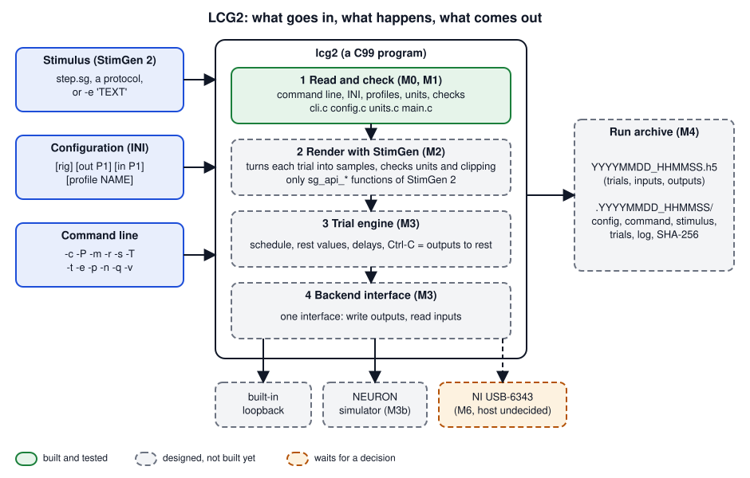

# LCG2 documentation

LCG2 is a small command-line program for cellular electrophysiology. It plays
a stimulus written in [StimGen 2](https://github.com/mgiugliano/StimGen) on the
analog and digital outputs of an acquisition board, and records the analog
inputs at the same time. It is a stripped-down successor of the LCG software,
written in ISO C99, with no dynamic clamp and no real-time kernel.

> **Where the project stands (read this first).**
> Milestones M0 and M1 are built and tested: the program reads the command line
> and the configuration file, applies rig profiles, checks everything and prints
> the plan with `-n`. **It does not play or record anything yet.** The link to
> StimGen (M2), the simulators (M3, M3b), the HDF5 recording (M4) and the board
> (M6) are designed and documented here, but not written. Every page says
> which parts are *built* and which are *designed*. The status of each piece is
> shown with the same marks everywhere:
>
> | Mark | Meaning |
> |:--|:--|
> | **Built** | exists in the code and is covered by `make test` |
> | **Designed** | decided in [`SPEC.md`](../SPEC.md), not written yet |

## Where to start

| You are... | Read, in this order |
|:--|:--|
| A user who wants to try it | [02 Quick start](02-quickstart.md), then [03 Tutorials](03-tutorials.md) |
| A user writing a rig configuration | [06 Configuration reference](06-config-reference.md), then [04 Concepts](04-concepts.md) |
| A user with an error message | [12 Error messages](12-error-messages.md) |
| A developer who will extend the code | [10 Architecture](10-architecture.md), then `SPEC.md` |
| An AI assistant picking up the work | [11 Notes for AI assistants](11-for-ai-agents.md) first, then [10 Architecture](10-architecture.md) |

## The pages

| Page | What it is |
|:--|:--|
| [01 Overview](01-overview.md) | what LCG2 is for, the big picture, the philosophy |
| [02 Quick start](02-quickstart.md) | build it, run the first dry run in five minutes |
| [03 Tutorials](03-tutorials.md) | step by step: one pipette, cc and vc, profiles, multi-patch, digital lines, safety limits |
| [04 Concepts](04-concepts.md) | the logic: channels, units, gain, calibration, limits, rest, trials, the run archive |
| [05 Command-line reference](05-cli-reference.md) | every flag, every rule |
| [06 Configuration reference](06-config-reference.md) | every section and key of the INI file |
| [07 StimGen and LCG2](07-stimgen.md) | how the stimulus language connects to LCG2 |
| [08 Simulators](08-simulators.md) | the built-in loopback and the NEURON backend (designed) |
| [09 Hardware](09-hardware.md) | the USB-6343, what its datasheet allows, why Linux is a problem |
| [10 Architecture](10-architecture.md) | the code: modules, data flow, tests, how to add a key |
| [11 Notes for AI assistants](11-for-ai-agents.md) | state, rules, traps, decisions, next steps |
| [12 Error messages](12-error-messages.md) | each message LCG2 can print, what it means, how to fix it |

## Figures

All figures are in [`figures/`](figures/) as SVG files. They are drawn by
[`figures/make_figures.py`](figures/make_figures.py); edit the script and run
`python3 docs/figures/make_figures.py` to regenerate them. Solid green means
built and tested, dashed grey means designed, dashed amber means waiting for a
decision.

## Keeping the documents true

- The commands shown in the tutorials, in lines that start with `$ ./lcg2`, are
  run by `make test` (see `tests/test_docs.py`). If a command or its exit
  status changes, the test fails until the page is fixed.
- Output samples were produced by the program itself (some are kept in
  [`outputs/`](outputs/)).
- The authoritative design is [`SPEC.md`](../SPEC.md). These pages explain it; if
  they disagree, the spec and the code win, and the page is a bug.
